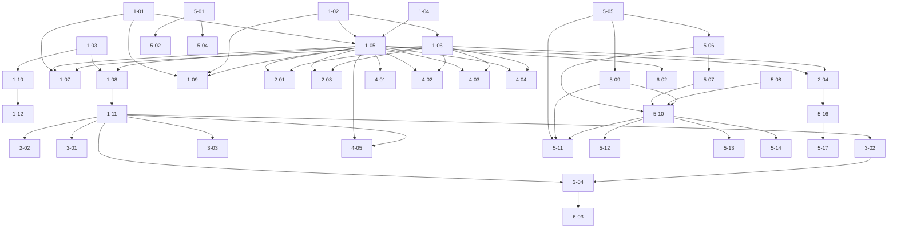

# Blackbox expansion — dependency graph and waves

Branch: `feat/blackbox-expansion`. One PR per group into `feat/investigation-timeline`. Never merge/auto-merge.
Rule: a packet is in wave N when all its dependencies are in earlier waves. Packets in the same wave run in parallel ONLY if they touch disjoint files (they do, by construction below). Parallel implementers use separate git worktrees; each wave is merged into the branch before the next starts. Tier is read from the packet header at dispatch (a human may edit it).

## Wave table

| Packet | Backlog | Depends on | Files touched | Wave | Tier | Reviewer |
|---|---|---|---|---|---|---|
| BBX-1-01 budget | BL-122 | — | budget.go | 1 | P | U |
| BBX-1-02 engine | BL-121 | — | engine.go | 1 | P | U |
| BBX-1-03 config targets | BL-117 | — | config.go | 1 | E | U |
| BBX-1-04 group types | many | — | groups_types.go, sample.go | 1 | E | U |
| BBX-1-05 group registry | BL-122/121 | 1-01,1-02,1-04 | groups.go | 2 | P | U |
| BBX-1-06 PDH source | BL-121/122 | 1-02 | pdh_windows.go, pdh_other.go | 2 | P | U |
| BBX-1-10 wizard endpoint | BL-117 | 1-03 | internal/server/blackbox.go | 2 | P | U |
| BBX-1-07 budget loop | BL-122 | 1-01,1-05,1-06 | recorder.go, host.go, selfstat_*.go | 3 | P | U |
| BBX-1-08 resolver proc | BL-105 | 1-03,1-05 | resolve.go, resolve_proc_windows.go, resolve_other.go | 3 | P | U |
| BBX-1-09 benchmark gate | BL-122 | 1-01,1-02,1-05 | budget_bench_test.go | 3 | P | U |
| BBX-1-12 wizard picker | BL-117 | 1-10 | web: BlackboxSettings.svelte, blackbox.ts, blackboxCopy.ts, tests | 3 | P | U |
| BBX-1-11 resolver map | BL-105 | 1-08 | resolve_map_windows.go, resolve_map_other.go | 4 | P | U |
| BBX-2-01 HTTP.sys | BL-104 | 1-05,1-06 | http.go | 4 | P | U |
| BBX-2-03 disk+CPU | BL-108 | 1-05,1-06 | diskcpu.go | 4 | P | U |
| BBX-2-04 SQL host counters | BL-100/107 | 1-05,1-06 | sqlhost.go | 4 | P | U |
| BBX-2-02 IIS worker | BL-106 | 1-11 | iis.go | 5 | P | U |
| BBX-3-01 CLR | BL-109 | 1-11 | clr.go | 5 | P | U |
| BBX-3-02 .NET10 fallback | BL-110 | 1-11 | proc10.go | 5 | P | U |
| BBX-3-03 per-proc I/O | BL-116 | 1-11 | procio.go | 5 | P | U |
| BBX-4-01 event log | BL-111 | 1-05 | events.go, events_windows.go, events_other.go | 6 | P | U |
| BBX-4-02 TCP | BL-112 | 1-05,1-06 | tcp.go, tcptable_*.go | 6 | P | U |
| BBX-4-03 ASP.NET | BL-114 | 1-05,1-06 | aspnet.go | 6 | E | U |
| BBX-4-04 mem pressure | BL-115 | 1-05,1-06 | mempressure.go | 6 | E | U |
| BBX-4-05 busiest shape | BL-125 | 1-05,1-11 | collector.go, sample.go | 6 | P | U |
| BBX-5-01 SQL service+DACL | BL-123 | — | sqlservice.go, sqlservice_windows.go, sqlservice_other.go | 7 | P | U |
| BBX-5-03 recorder codes | BL-123 | — | recorder.go | 7 | P | U |
| BBX-5-05 allowlist+lint | BL-124 | — | bbsql/allowlist.go | 7 | P | U |
| BBX-5-08 back-off | BL-124 | — | bbsql/backoff.go | 7 | P | U |
| BBX-5-02 SQL CLI+grant | BL-123/124 | 5-01 | cmd/unravis-blackbox/* | 8 | P | U |
| BBX-5-04 /status C11 | BL-123 | 5-01 | server.go | 8 | P | U |
| BBX-5-06 conn controls | BL-124 | 5-05 | bbsql/conn.go | 8 | P | U |
| BBX-5-09 output+caps | BL-124 | 5-05 | bbsql/output.go | 8 | P | U |
| BBX-5-07 ceiling+errors | BL-124 | 5-06 | bbsql/ceiling.go, errors.go | 9 | P | U |
| BBX-5-10 runner+C13 | BL-124 | 5-06,5-07,5-08,5-09 | bbsql/runner.go, budget_test.go | 10 | P | U |
| BBX-5-11 requests | BL-101 | 5-05,5-09,5-10 | bbsql/requests.go | 11 | P | U |
| BBX-5-12 waits | BL-102 | 5-05,5-09,5-10 | bbsql/waits.go | 11 | P | U |
| BBX-5-13 schedulers | BL-118 | 5-05,5-09,5-10 | bbsql/sched.go | 11 | P | U |
| BBX-5-14 filestats+AG | BL-119 | 5-05,5-09,5-10 | bbsql/filestats.go | 11 | P | U |
| BBX-5-16 lane server | BL-103 | 2-04 | internal/server/tracing*.go, blackbox.go | 12 | P | U |
| BBX-6-02 dump catalogue | BL-120 | 1-05 | dumps.go | 12 | P | U |
| BBX-5-17 lane web | BL-103 | 5-16 | web: dbState.ts, drillCopy.ts, SlowCallScreen.svelte, tests | 13 | P | U |
| BBX-3-04 EventPipe | BL-110 | 1-11,3-02 | **BLOCKED** (live pipe proof + cost) | — | P | U |
| BBX-6-01 VM steal | BL-113 | 1-05,1-06 | **BLOCKED** (live typeperf on VM) | — | P | U |
| BBX-6-03 alloc sampling | BL-126 | 3-04 | **BLOCKED** (EventPipe proof + cost + owner go) | — | P | U |

## Waves and parallelism

- **Wave 1** (4 parallel): 1-01, 1-02, 1-03, 1-04 — disjoint new files + config.go + sample.go.
- **Wave 2** (3 parallel): 1-05, 1-06, 1-10.
- **Wave 3** (4 parallel): 1-07, 1-08, 1-09, 1-12.
- **Wave 4** (4 parallel): 1-11, 2-01, 2-03, 2-04.
- **Wave 5** (4 parallel): 2-02, 3-01, 3-02, 3-03.
- **Wave 6** (5 parallel): 4-01, 4-02, 4-03, 4-04, 4-05.
- **Wave 7** (4 parallel, SQL 5a): 5-01, 5-03, 5-05, 5-08.
- **Wave 8** (4 parallel): 5-02, 5-04, 5-06, 5-09.
- **Wave 9** (1): 5-07.
- **Wave 10** (1): 5-10. **→ ULTIMATE GATE: review BL-123+BL-124 (waves 7–10) before any sampler.**
- **Wave 11** (4 parallel, samplers): 5-11, 5-12, 5-13, 5-14.
- **Wave 12** (2 parallel): 5-16, 6-02.
- **Wave 13** (1): 5-17.
- **Blocked** (written, not dispatched): 3-04, 6-01, 6-03.

## Critical path

Foundation: 1-04 → 1-05 → 1-06 → 1-07 (budgeted loop) and 1-05 → 1-08 → 1-11 (resolver) gate the per-process groups.
Longest chain (SQL): 5-05 → 5-06 → 5-07 → 5-10 → {5-11..5-14} → 5-16 → 5-17. The Ultimate gate after wave 10 is a hard stop before samplers.

## Live-server-blocked packets

- BBX-3-04 (BL-110 EventPipe): SYSTEM→diagnostic-pipe proof + in-target cost. Fallback BBX-3-02 ships now.
- BBX-6-01 (BL-113 VM steal): `typeperf -q` on a real Hyper-V/VMware VM.
- BBX-6-03 (BL-126 alloc sampling): depends on 3-04 proof + cost + owner go.
- All counter groups (2-01..2-04, 3-01..3-03, 4-01..4-04) and SQL samplers are fake-tested now but need a real-server `typeperf -q` / SSMS check before their backlog items are ticked.

## Mermaid

