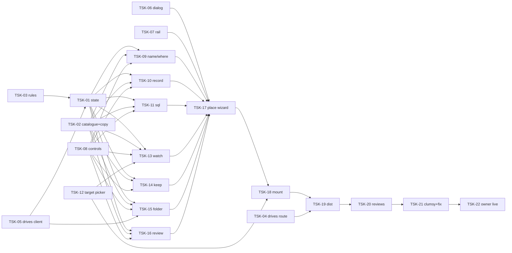

# Dependency graph: blackbox-wizard-popup

| Packet | Depends on | Files touched | Wave | Size |
|---|---|---|---|---|
| TSK-02 catalogue + copy | - | `web/src/lib/blackboxCatalogue.ts`, `web/src/lib/copy/blackboxWizardCopy.ts`, test | 1 | medium |
| TSK-03 folder/keep rules | - | `web/src/lib/blackbox.ts`, test | 1 | small |
| TSK-04 drives route | - | `internal/server/blackbox_drives*.go`, 1 line in `blackbox.go` | 1 | medium |
| TSK-05 drives client | - | `web/src/lib/blackboxDrives.ts`, test | 1 | small |
| TSK-06 dialog shell | - | `WizardDialog.svelte`, `web/src/lib/wizardKeys.ts`, test | 1 | strong |
| TSK-07 progress rail | - | `ProgressRail.svelte` | 1 | small |
| TSK-08 shared controls | - | `SegmentedControl`, `RadioCards`, `FigureDetails` | 1 | medium |
| TSK-12 extract target picker | - | `BlackboxTargetPicker.svelte`, `BlackboxSettings.svelte` | 1 | strong |
| TSK-01 wizard state | 03, 05 | `web/src/lib/blackboxWizard.ts`, test | 2 | strong |
| TSK-09 Name + Where | 01, 02, 08 | `StepName`, `StepWhere` | 3 | small |
| TSK-10 Record | 01, 02, 08 | `StepRecord` | 3 | medium |
| TSK-11 SQL info | 01, 02, 08 | `StepSql` | 3 | small |
| TSK-13 Watch | 01, 02, 08, 12 | `StepWatch` | 3 | medium |
| TSK-14 Keep | 01, 02, 08 | `StepKeep` | 3 | small |
| TSK-15 Folder | 01, 02, 05, 08 | `StepFolder` | 3 | medium |
| TSK-16 Review + result | 01, 02, 08 | `StepReview`, `ResultView` | 3 | medium |
| TSK-17 Place wizard | 01, 02, 06, 07, 09, 10, 11, 13, 14, 15, 16 | `BlackboxPlaceWizard.svelte`, copy keys only | 4 | strong |
| TSK-18 mount, delete old | 17, 12 | `BlackboxPanel.svelte`, delete `BlackboxWizard.svelte` | 5 | medium |
| TSK-19 dist rebuild | 18, 04 | `web/dist/**` | 6 | small |
| TSK-20 reviews | 19 | `.forge/.../reviews/*` | 7 | strong |
| TSK-21 clumsy-user + fix | 20 | findings' files, `web/dist/**` | 8 | medium |
| TSK-22 owner live run | 21 | `docs/BACKLOG.md`, `progress.md` | 9 | owner + small |

No two packets in the same wave write the same file. `blackboxWizardCopy.ts` is written by TSK-02 (wave 1) and later only by TSK-17 (wave 4). `blackbox.ts` is written by TSK-03 (wave 1) and later only by TSK-18 (wave 5).

Critical path: TSK-03 → TSK-01 → TSK-15 (or TSK-10/13/16) → TSK-17 → TSK-18 → TSK-19 → TSK-20 → TSK-21 → TSK-22.
Near-critical: TSK-12 → TSK-13 → TSK-17 (two strong packets; start TSK-12 on day one).

Parallel groups:
- Wave 1 (8 at once): TSK-02, 03, 04, 05, 06, 07, 08, 12.
- Wave 3 (7 at once): TSK-09, 10, 11, 13, 14, 15, 16.
- Everything after wave 3 is serial.

Gated packets: TSK-04 and TSK-05 on OD-5 (drop them and TSK-15 shows the typed path only); TSK-11 on OD-4 (drop it and `steps()` never returns `sql`).
