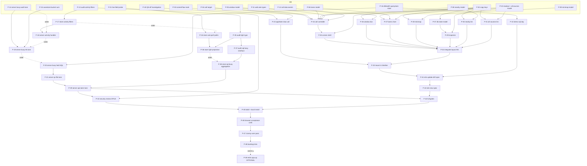

# Dependency graph: Slow call screen

49 packets (P-01..P-48 scheduled, P-49 optional) plus 6 later packets (L-20..L-25, one file, not scheduled). 12 waves. Packets in one wave have no overlapping write scope and may run in parallel (cap: 6 agents at a time).

## Graph

Dotted "order" edges are not data dependencies: they are the one-writer-per-Go-package rule.

## Table

| Packet | Depends on | Write scope | Model / effort | Risk | Wave |
|---|---|---|---|---|---|
| P-01 live field probe | none (needs live app) | `screen/probe/fields.md` | sonnet / medium | medium | W0 |
| P-02 copy keys | none | `web/src/lib/drill/drillCopy.ts`, `web/tests/drill.copy.test.cjs` | sonnet / medium | low | W0 |
| P-03 screenFlow mark | none | `web/src/lib/screenFlow.ts`, `web/tests/slowcall.flow.test.cjs` | haiku / low | low | W0 |
| P-04 call target | none | `web/src/lib/drill/callTarget.ts`, test | sonnet / medium | medium | W0 |
| P-05 window model | none | `web/src/lib/drill/callWindow.ts`, test | sonnet / medium | low | W0 |
| P-06 lanes model | none | `web/src/lib/drill/callLanes.ts`, test | sonnet / high | medium | W0 |
| P-08 nearby model | none | `web/src/lib/drill/nearbyCalls.ts`, test | sonnet / medium | low | W0 |
| P-09 minimap model | none | `web/src/lib/drill/callMap.ts`, test | sonnet / medium | low | W0 |
| P-10 readout + all sources model | none | `web/src/lib/drill/callReadout.ts`, test | sonnet / medium | low | W0 |
| P-11 web wire types | none | `web/src/lib/tracing/model.ts`, `web/src/lib/types.ts`, `web/src/lib/tracing/lanes.ts` | haiku / low | low | W0 |
| P-12 call data events | none | `web/src/lib/drill/callData.ts`, test | sonnet / low | low | W0 |
| P-13 audit activity filters | none | `internal/audit/activity.go`, `activity_demo.go`, `activity_test.go` | sonnet / medium | medium | W0 |
| P-14 server busy audit lane | none | `internal/server/tracing.go` (bucket struct), `tracing_audit_latency.go`, `tracing_audit.go`, test | sonnet / high | medium | W0 |
| P-15 casestore bucket sum | none | `internal/casestore/buckets.go`, test | sonnet / high | medium | W0 |
| P-16 dbhealth querystore state | none | `internal/dbhealth/lane.go`, `lane_sql.go`, `lane_sql_test.go` | sonnet / high | HIGH | W0 |
| P-40 QS-off investigation | none | `screen/probe/qs-off-history.md` | sonnet / medium | medium | W0 |
| P-07 db state model | P-02 | `web/src/lib/drill/dbState.ts`, test | sonnet / medium | medium | W1 |
| P-17 store activity filters | P-13 | `internal/store/activity.go`, test | sonnet / high | HIGH | W1 |
| P-22 demo sql day | P-16 | `cmd/audit-explorer/demo_cases.go`, test | sonnet / medium | low | W1 |
| P-23 appState slow call | P-03, P-04 | `web/src/lib/appState.svelte.ts`, `web/tests/slowcall.appstate.test.cjs` | sonnet / high | HIGH | W1 |
| P-24 call controller | P-04, 05, 06, 08, 10, 11, 12 | `web/src/lib/drill/callController.ts`, test | sonnet / high | medium | W1 |
| P-26 window bar | P-02, P-05 | `web/src/components/CallWindowBar.svelte`, test | sonnet / medium | low | W1 |
| P-27 lanes chart | P-02, P-06, P-10 | `web/src/components/CallLanes.svelte`, test | sonnet / high | medium | W1 |
| P-28 minimap | P-02, P-09 | `web/src/components/CallMinimap.svelte`, test | sonnet / medium | medium | W1 |
| P-30 nearby list | P-02, P-08 | `web/src/components/CallNearby.svelte`, test | sonnet / medium | low | W1 |
| P-31 all sources list | P-02, P-10 | `web/src/components/CallAllSources.svelte`, test | sonnet / low | low | W1 |
| P-35 audit light type | P-13 (order) | `internal/audit/models.go`, `demo.go`, test | sonnet / medium | medium | W1 |
| P-18 server activity handler | P-13, P-17; after P-14 | `internal/server/activity.go`, test | sonnet / medium | medium | W2 |
| P-25 screen shell | P-02, 04, 11, 12, 24 | `web/src/components/SlowCallScreen.svelte`, `web/tests/slowcall.screen.test.cjs` | sonnet / medium | medium | W2 |
| P-29 inspector | P-02, P-07, P-10 | `web/src/components/CallInspector.svelte`, test | sonnet / medium | low | W2 |
| P-34 store wire perf paths | P-01 result; after P-17 | `internal/store/record_perf.go`, test | sonnet / medium | HIGH | W2 |
| P-37 audit sql busy interface | P-35 | `internal/audit/sqlbusy.go`, `sqlbusy_demo.go`, test | sonnet / medium | medium | W2 |
| P-19 server busy IIS lane | P-14, P-15; after P-18 | `internal/server/tracing.go` (`bucketLane`), test | sonnet / medium | medium | W3 |
| P-32 integrate layout W1 | P-25..P-31, P-07 | `web/src/components/SlowCallScreen.svelte`, its test | sonnet / high | HIGH | W3 |
| P-36 store light projection | P-34, P-35 | `internal/store/requests.go`, `record_perf.go` (helper), test | sonnet / high | HIGH | W3 |
| P-20 server busy held SQL | P-14, P-16; after P-19 | `internal/server/tracing.go` (lane struct), `tracing_sqllive.go`, test | sonnet / high | medium | W4 |
| P-33 mount in timeline | P-23, P-32 | `web/src/components/TracingPaper.svelte`, `web/tests/drill.paper.test.cjs` | sonnet / high | HIGH | W4 |
| P-38 store sql busy aggregation | P-34, P-37; after P-36 | `internal/store/sqlbusy.go`, test | sonnet / high | HIGH | W4 |
| P-21 server qs-file lane | P-20 | `internal/server/tracing_qsfile.go`, test, one call site in `tracing.go` | sonnet / high | HIGH | W5 |
| P-41 e2e update drill spec | P-33 (and P-22 for the demo) | `tools/e2e/specs/timeline-drill.spec.ts` | sonnet / medium | medium | W5 |
| P-39 server api-seen lane | P-21, P-37, P-38 | `internal/server/tracing_apiseen.go`, test, one call site in `tracing.go` | sonnet / high | HIGH | W6 |
| P-42 e2e new spec | P-41 | `tools/e2e/specs/slow-call-screen.spec.ts`, `tools/e2e/COVERAGE.md` | sonnet / high | medium | W6 |
| P-43 security review | P-13, 16, 17, 18, 20, 21, 34..40 | `screen/reviews/RB-6-security.md` (read-only on code) | opus / high | HIGH | W7 |
| P-44 full gates | P-39, P-42 | `screen/reviews/gates.md` | haiku / low | low | W7 |
| P-45 build + local install | P-43 SHIP, P-44 PASS | `dist/` output, `screen/reviews/install.md` | sonnet / low | medium | W8 |
| P-46 browser acceptance LIVE | P-45 | `screen/reviews/acceptance.md`, `shots/` | sonnet / medium | medium | W9 |
| P-47 clumsy-user pass | P-46 | `screen/reviews/clumsy.md`, `tools/e2e/specs/slow-call-screen.spec.ts` (append) | sonnet / medium | low | W10 |
| P-48 backlog ticks | P-46, P-47 | `docs/BACKLOG.md` | sonnet / low | low | W11 |
| P-49 retire pop-up (OPTIONAL) | P-48 + owner go | `DrillPopup.svelte`, its test, unused copy keys | sonnet / medium | medium | none |
| L-20..L-25 | see `packets/later/` | see file | sonnet (opus for security) | mixed | none |

## Waves

| Wave | Packets (parallel) | Count |
|---|---|---|
| W0 | P-01, P-02, P-03, P-04, P-05, P-06, P-08, P-09, P-10, P-11, P-12, P-13, P-14, P-15, P-16, P-40 | 16 |
| W1 | P-07, P-17, P-22, P-23, P-24, P-26, P-27, P-28, P-30, P-31, P-35 | 11 |
| W2 | P-18, P-25, P-29, P-34, P-37 | 5 |
| W3 | P-19, P-32, P-36 | 3 |
| W4 | P-20, P-33, P-38 | 3 |
| W5 | P-21, P-41 | 2 |
| W6 | P-39, P-42 | 2 |
| W7 | P-43, P-44 | 2 |
| W8 | P-45 | 1 |
| W9 | P-46 | 1 |
| W10 | P-47 | 1 |
| W11 | P-48 | 1 |

Write-scope check per wave: no file appears twice inside one wave. W0 has one writer each in `internal/audit` (P-13), `internal/server` (P-14), `internal/casestore` (P-15), `internal/dbhealth` (P-16). W1: `internal/store` (P-17), `internal/audit` (P-35), `cmd/audit-explorer` (P-22). W2: `internal/server` (P-18), `internal/store` (P-34), `internal/audit` (P-37). W3: server (P-19), store (P-36). W4: server (P-20), store (P-38). W5: server (P-21). W6: server (P-39).

## One-writer chains (must stay in this order)

- `internal/server`: P-14 → P-18 → P-19 → P-20 → P-21 → P-39
- `internal/store`: P-17 → P-34 → P-36 → P-38
- `internal/audit`: P-13 → P-35 → P-37
- `web/src/components/SlowCallScreen.svelte`: P-25 → P-32
- `tools/e2e/specs/slow-call-screen.spec.ts`: P-42 → P-47
- single writers: `drillCopy.ts` (P-02), `appState.svelte.ts` (P-23), `TracingPaper.svelte` (P-33)

## Critical path

P-13 → P-17 → P-18 → P-19 → P-20 → P-21 → P-39 → P-44 → P-45 → P-46 → P-47 → P-48 (12 steps; the Go server chain sets the length).

The UI path is shorter and has slack of one wave: P-02 / P-06 → P-24 → P-25 → P-32 → P-33 → P-41 → P-42 → P-44.

## Conditional packets

- P-34, P-36, P-38 depend on what P-01 finds. If P-01 is BLOCKED or finds nothing, they report "skipped" and the chain goes on: P-39 still builds (demo path works; live answer is "not recorded").
- P-40's live half and P-46 need the owner's live sources.
