# Cases

A case keeps one investigation together: the files you added, your theories, the health checks you ran, and the story of what you did. Cases are saved on this computer, in your Unravis folder.

## The case list

The start page lists your cases. Open one, type a case code, restore a case from a case file, or create a new case. A closed case is marked Closed.

The case list pictures show made-up cases from the capture demo. They are not real investigations.

## Create a case

Press Create a new case. The guide walks you through the steps. Step 1 asks what you are looking at.

### Pressing Create twice, reloading, or closing the window

Each run of the guide has its own request number, kept in this browser tab. Unravis makes one case for one request number. So these all end with one case, not two:

- You press Create twice, or press it again because nothing seemed to happen.
- You reload the page in the middle of Create. The same title picks up the same request number.
- The computer or Unravis stops in the middle of Create. When Unravis starts again it finishes the steps that were left.

If you press Create for a case that was already made and then archived, you see "This case was already made. Find it on the start screen." Starting the guide again from the start, or changing the title, makes a new case.

## Case home

Case home shows what happened so far, in order, oldest first. It shows only what the case has saved: when it started, the files you added, your theories and your health checks.

On a narrow window:

## Health checks

Health checks look at the SQL Server or MongoDB your logs depend on and say in plain words what looks healthy and what needs a look. They only read. They run only when you press Run checks.

The demo has no SQL Server kept and has run no checks, so these pictures show the empty state: "No SQL Server is kept yet" and "No checks have been run". Pictures with results arrive with the health-check phase.

## Export evidence

Export builds a file of the findings in the window you are looking at. You see a preview before anything is saved.

## Close and Reopen

Close puts a case away without losing anything. A closed case can be read, but nothing can be added to it: no files, no theories, no checks. Close is on the Import page, next to each open case. Case home then says "This case is closed. You can read it, but nothing can be added." and the story shows "Case closed".

Closing is not final. Press Reopen on Case home (or on the Import page, in the row of the closed case) and the case is open again. Reopen:

- changes nothing but the state: the case is open again and what you may add to it is back;
- never starts anything by itself. Sampling and checks start only when you press them;
- writes "Case reopened" into the story.

A closed case is still erased 30 days after it was closed, unless you reopen it.

The MongoDB link and the filters the case had are not part of Reopen. They are saved with the case as you work, and Unravis puts them back whenever you open the case, closed or not. While the case is closed they cannot be changed, so nothing new is saved; once you reopen it, saving carries on.

Screens: `p2-close` is the case list on the Import page. `p2-closed-readonly` is a closed case with its buttons turned off. `p2-reopen` is the same case with the Reopen button. The pictures are made by `tools/screens/run-screens.ps1 -Update`.

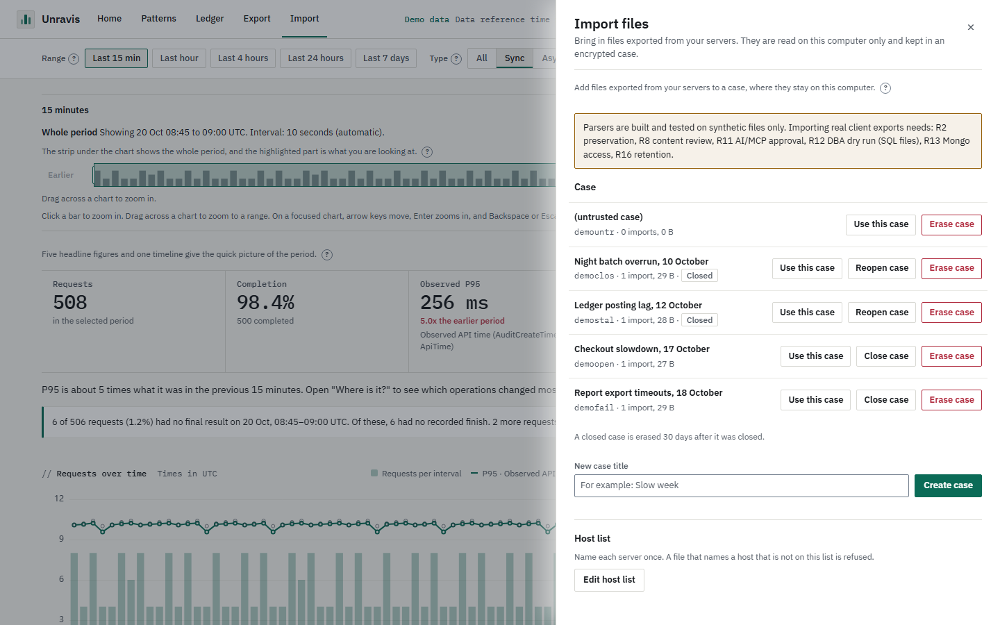
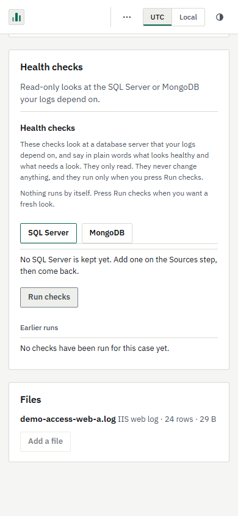
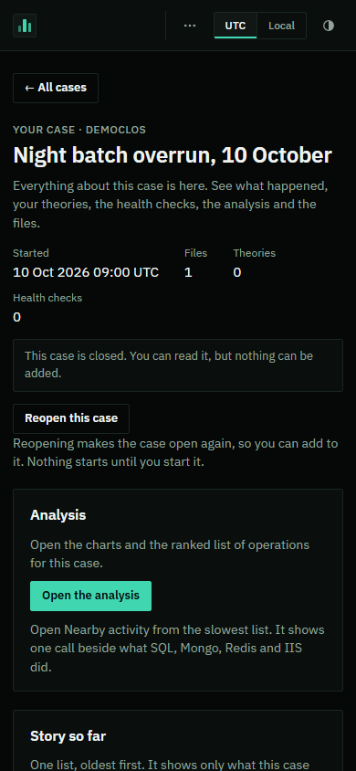

Pressing Reopen twice quickly sends one request. The second press does nothing while the first is running.

## Needs another try

When you create a case and some steps do not go through (an environment list that was not saved, a source that was not tagged, a file that could not be read), the case is still made. What did not go through is kept in the case, in a list called Needs another try. It stays after you close Unravis, and it travels inside a case file.

Each item says what failed, in one of four ways. They are different on purpose:

| Label | What it means | Try again does |
|---|---|---|
| Environments not saved | The environment names were not saved. | Saves them again. |
| Source not saved | A log source was not tagged. | Tags it again. |
| Not added to analysis | A database was connected but not added as an audit source. | Nothing here. The line says to add it again from Connections. |
| Import failed | A file could not be read. | Opens the file picker, because the file has to be chosen again. |

You can also Remove an item from the list. On a closed case the list says "This case is closed. Reopen it to try again." and shows no buttons. The list never keeps passwords or text from your files.

Screen: `p2-retry-list`. The list sits above Analysis, and Case home counts the items in the header ("Needs another try").

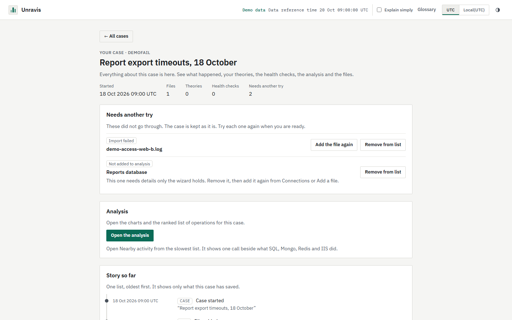

## Two tabs

You can have the same case open in two browser tabs. Every case action checks what the page believes the case is (open, closed) against what it is now, and only one action runs on a case at a time.

If another tab changed the case first, the page changes nothing and says: "This case changed in another tab." with a Reload button. Press Reload to see the case as it is now. Until you do, Reopen and the retry buttons on that page are turned off. In the Import page's case list the same refusal says the list now shows how the case is, because the list has already refreshed. This is the 409 answer with the message id M2. It is different from the two older answers: 423 means the master key is locked, and 409 "untrusted" means the case was not opened because its folder was not here when the key was set up.

Examples: you close a case in tab A, and then add a file in tab B. Tab B is told the case is closed. You press Reopen in two tabs: the first reopens, the second sees M2.

Screen: `p2-changed-elsewhere`. A second tab reopens the case, then the first tab presses Reopen. The tool puts the case back as it was afterwards.

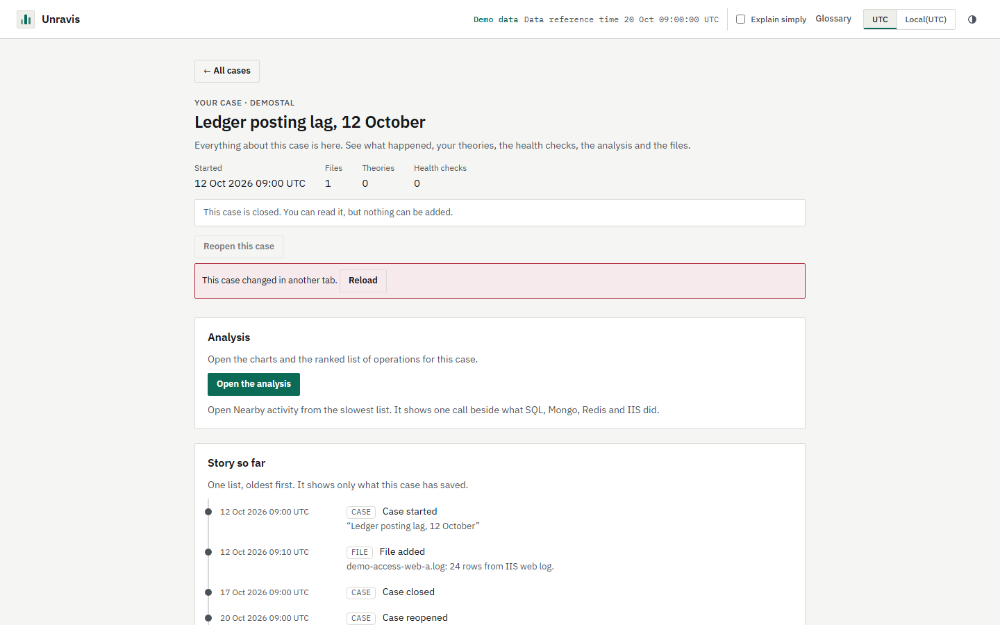
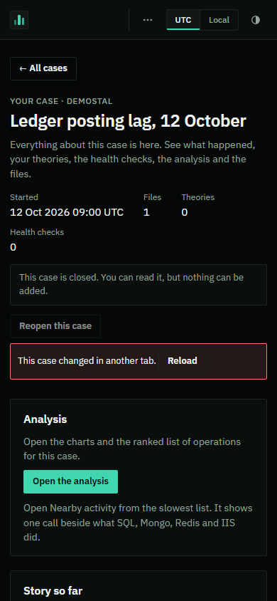

## Archive

Archive saves the whole case in one file you can keep, copy or move. You do not need to close the case first. Press "Archive this case" on Case home, choose a folder, and press "Archive the case".

- The folder must be a drive path you can write to. A network drive, a relative path, a short 8.3 name and a folder inside Unravis's own folders are refused. Unravis's own folders are the cases folder, the folder that holds it, and the folder with the master key file, saved connections and history.
- The file is sealed with the master key of this computer. Without a master key you type a passphrase of at least 12 characters. Keep it: without it the file cannot be opened.
- Closing the drawer while the file is written does not stop the archive. Case home says "This case is being archived." with a percent and a "Show progress" button, and updates by itself when the archive is done.
- While the file is written the case is marked "Archiving". It can be cancelled ("Cancel archiving"); the case is then back as it was.
- When the file is written, Unravis reads it back to check it, and only then marks the case "Archived". An archived case is read-only. It moves to the Archived list on the start screen, and the working copy is kept.
- A case file Unravis finished but could not commit (for example Cancel at the last moment) is never deleted. It is listed under "Case files left over" in the health checks. See Troubleshooting.

Screens: `p3-archive` is the drawer on an open case.

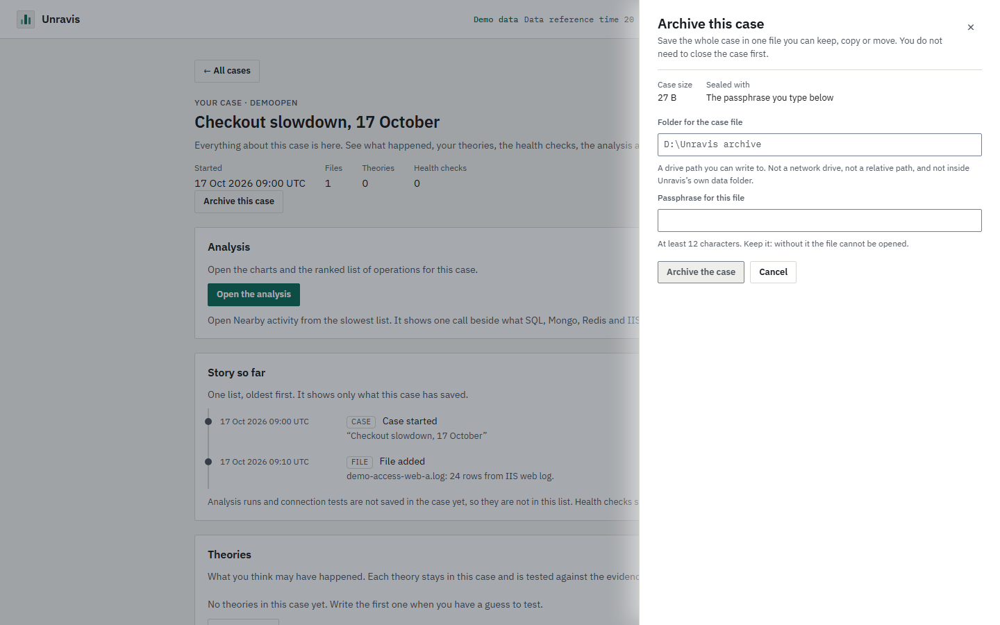
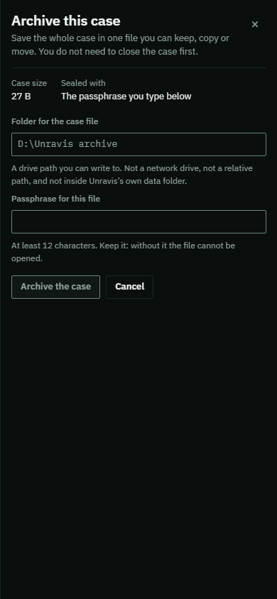

## Check the case file

"Check the case file" proves the case file can be restored. Unravis restores it to a temporary store (the `.verify` folder under the case root), compares it with the case, and removes the temporary store. The check does not change the case or the file. It can be cancelled. A passed check counts for one hour and only for that exact file: a file that changed since has to be checked again. A passed check is never trusted on its own to free space (see below).

If the file is missing or does not match, the check fails with "The case file did not pass the check. The working copy was kept."

## Free the space

Free removes the working copy of an archived case to get its space back. The case file stays and becomes the only copy. It has three stages:

1. Check the case file. This is the check above. Free cannot go on without a pass.
2. Confirm. The page shows the file that will be the only copy and warns that it can only be opened with the key it was made with. Type the case code.
3. Freeing. Just before anything is erased, and while no one else can change the case, Unravis checks the record and reads the case file again. If the file was deleted, moved, cut short, replaced, or archived again since the check, Free stops with "The case file did not pass the check. The working copy was kept." and the check has to be made again. Then a "being freed" flag stops new readers while the working copy goes. If something stops in the middle, Unravis finishes or undoes it the next time it starts; the case file is never touched.

Free and Restore as a new case need the master key of this computer to be set up and unlocked. If there is no master key yet, the drawer says "This needs the master key of this computer. Set a master key first." with a "Set a master key" button, before the check starts. Nothing is changed. Restore in place does not need the key.

Before a master key is reset ("Start over with a new master key"), the page says how many freed archived cases are sealed with the old key and that they can no longer be opened after the reset.

A freed case is not "Missing". An archived case page is read-only: the analysis and Reopen are not offered, and the page says to restore first. A freed case stays in the Archived list, labelled "Space freed", and can be restored as a new case.

Screens: `p3-free-1` is the first stage.

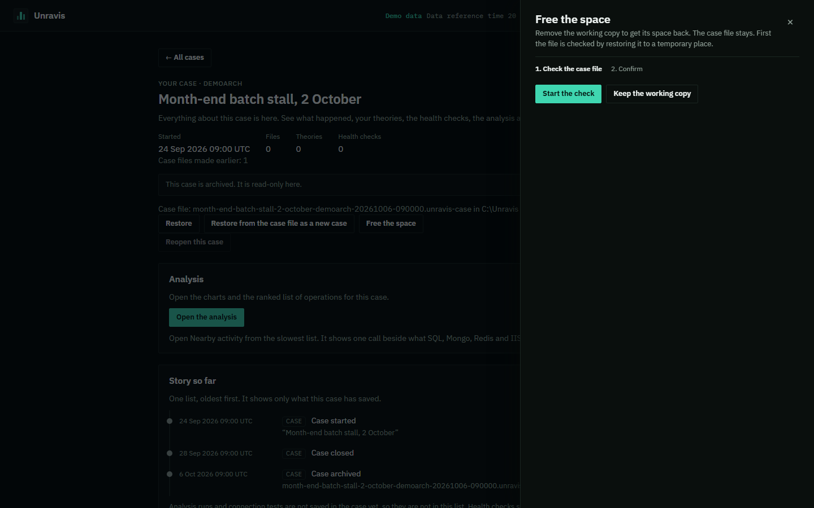
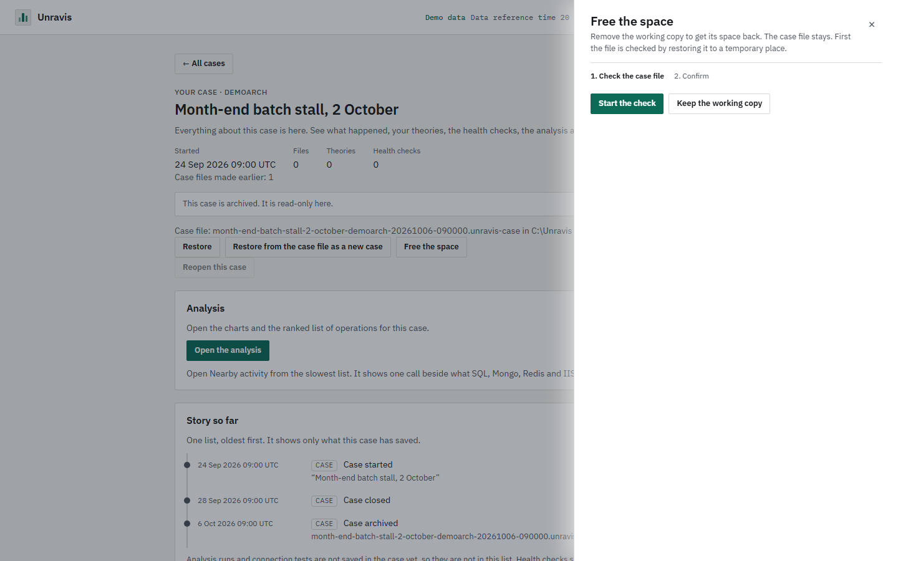

## Restore

There are two ways back.

- Restore (in place) puts the case back in the working list. It is only offered while the working copy was kept, and nothing is read from the case file. The case ends Closed: Reopen it to add data.
- Restore from the case file as a new case reads the file and makes a new case with a new code. The archived case and the file are not changed. If the file was sealed with a typed passphrase, type it. A file sealed with the master key needs the same master key. The form on the start screen takes either a master key or a passphrase. A file that can only be opened with a different key says so, and the way out: use Restore from a case file with the master key or passphrase it was made with.

A case file made before this version still restores with "Restore from a case file" on the start screen.

Screens: `p3-restore-in-place` and `p3-restore-as-new`.

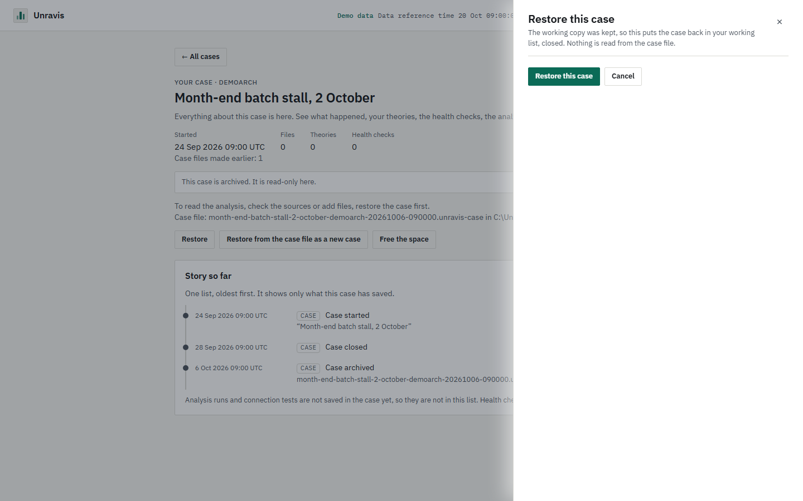
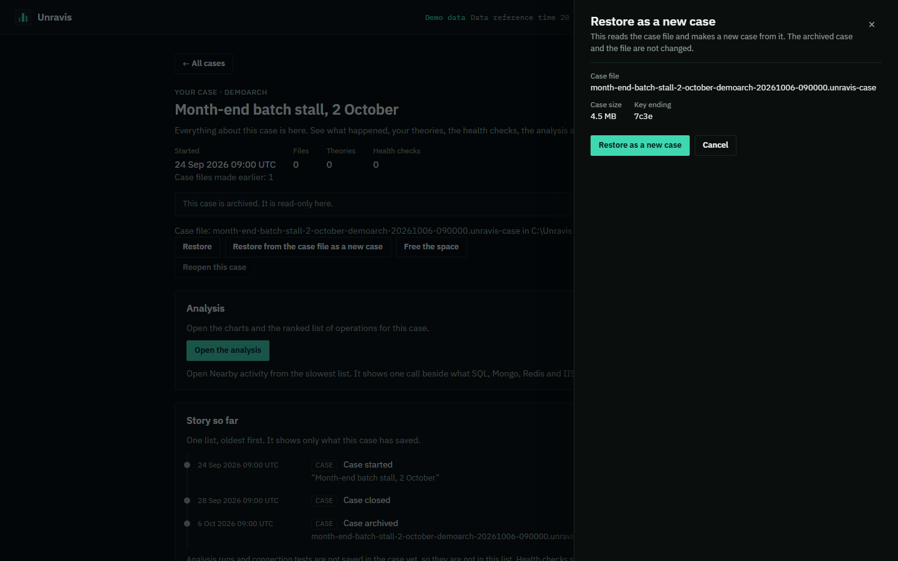

## The Archived list

The start screen shows "Archived cases (N)" under the working cases. The list is paged 50 at a time with "Show more archived cases". Each row shows the short case code ("Code 3f9a27c1"), so a case restored twice from one file can be told apart. Each row says "Archived", whether the working copy is kept or the space is freed, and "Key ending xxxx". A row whose working copy has disappeared reads "Working copy missing" and offers no Open. Rows offer Open, Restore and, under More, "Restore from the case file as a new case", "Free the space" and Erase.

Screens: `p3-archived-list` is the list. `p3-archived-home` is Case home of an archived case.

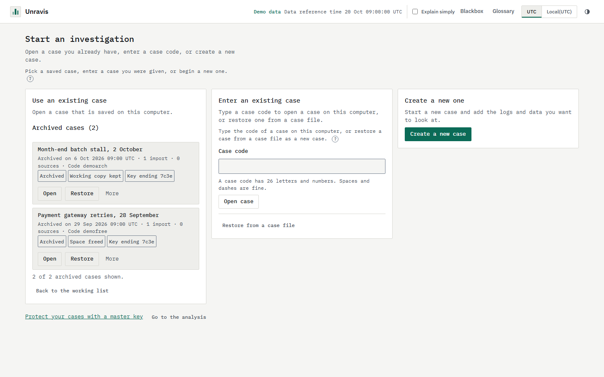
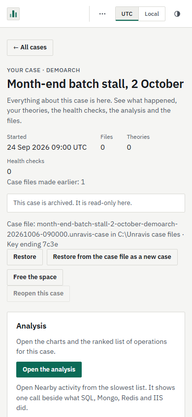

## History

Case home keeps a history of the case files made and the restores: "Case files made earlier", with the file name, the folder and "Key ending xxxx". The ending is the last four characters of the key check value, so two files made with different keys can be told apart without showing the key. The story lists "Case archived", "Space freed" and "Restored as a new case" with their times.

## Coming later

- Case keys and erase: Coming in P4.
