# Cases

A case keeps one investigation together: the files you added, your theories, the health checks you ran, and the story of what you did. Cases are saved on this computer, in your Unravis folder.

## The case list

The start page lists your cases. Open one, type a case code, restore a case from a case file, or create a new case. A closed case is marked Closed.

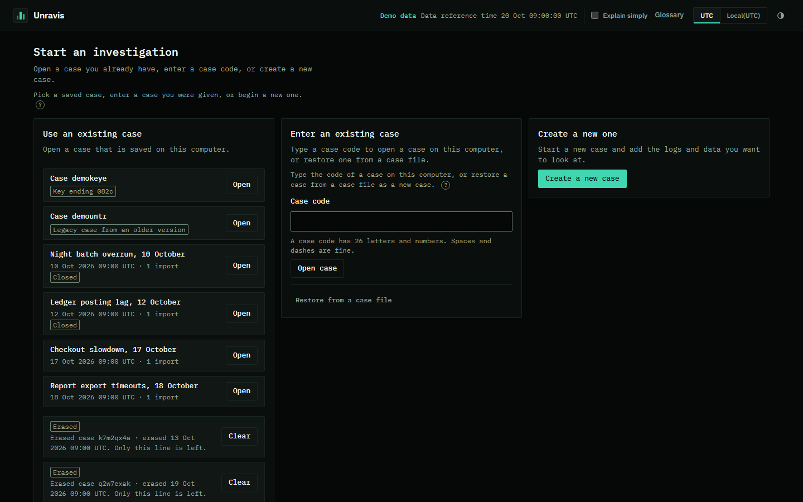
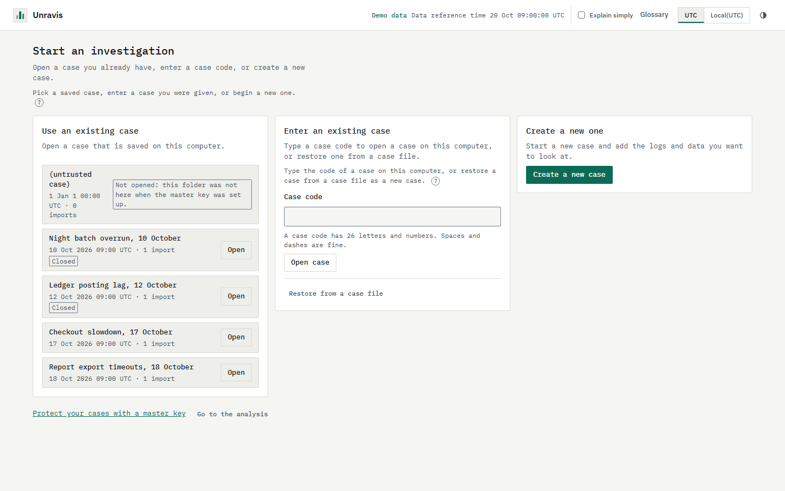

The case list pictures show made-up cases from the capture demo. They are not real investigations.

## Create a case

Press Create a new case. The guide walks you through the steps. Step 1 asks what you are looking at.

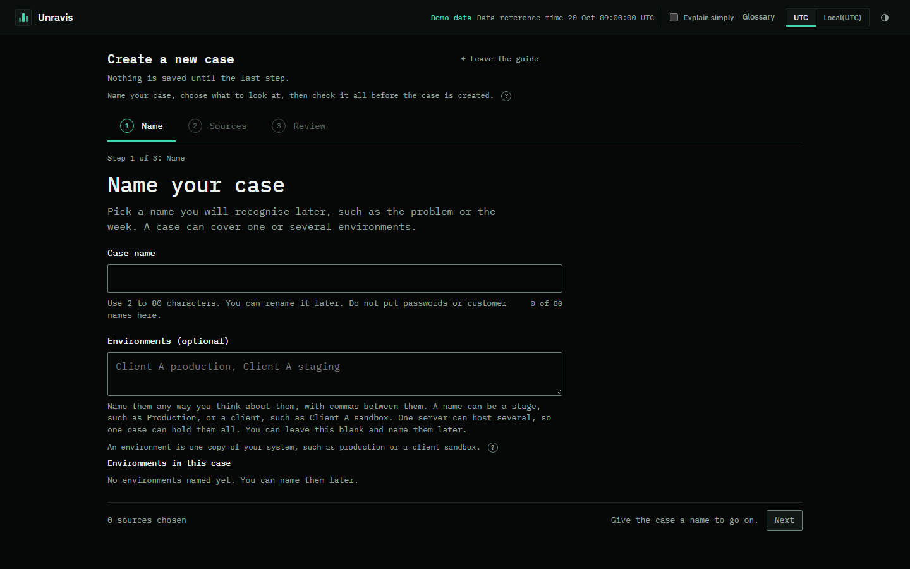
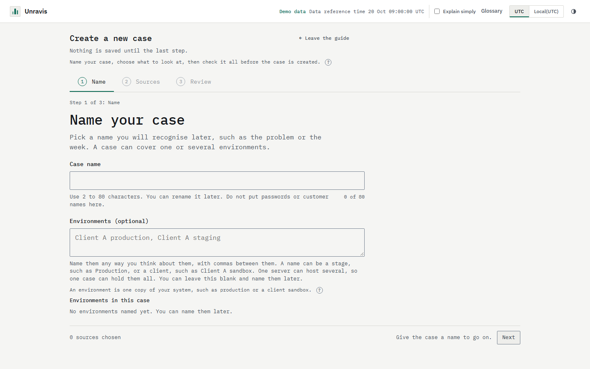

## Case home

Case home shows what happened so far, in order, oldest first. It shows only what the case has saved: when it started, the files you added, your theories and your health checks.

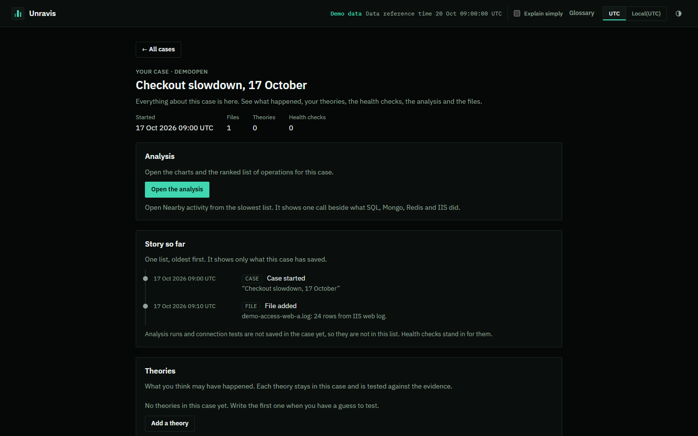
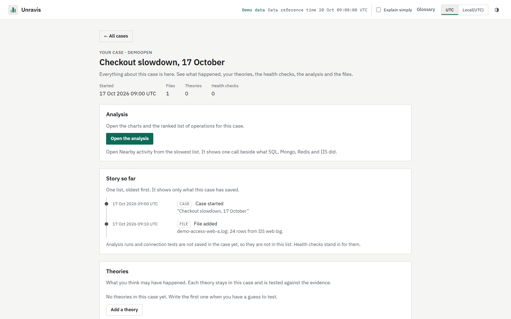

On a narrow window:

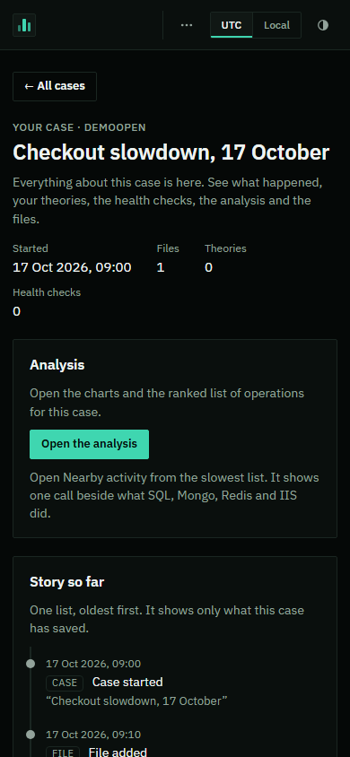
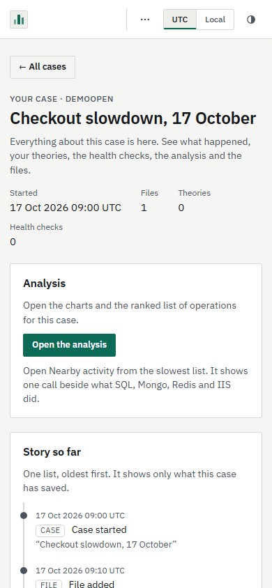

## Health checks

Health checks look at the SQL Server or MongoDB your logs depend on and say in plain words what looks healthy and what needs a look. They only read. They run only when you press Run checks.

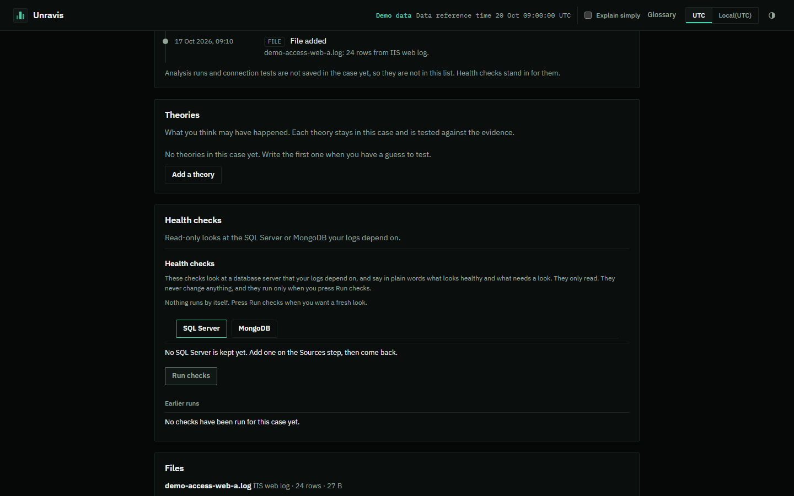
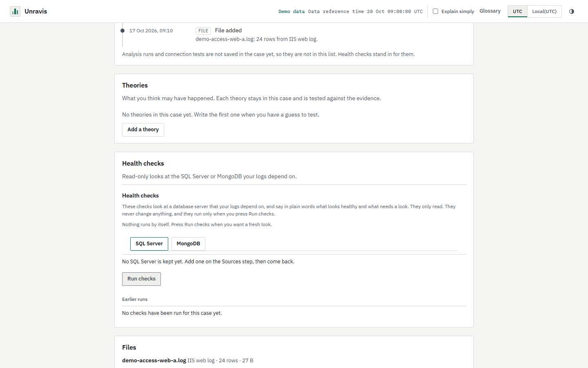

The demo has no SQL Server kept and has run no checks, so these pictures show the empty state: "No SQL Server is kept yet" and "No checks have been run". Pictures with results arrive with the health-check phase.

## Export evidence

Export builds a file of the findings in the window you are looking at. You see a preview before anything is saved.

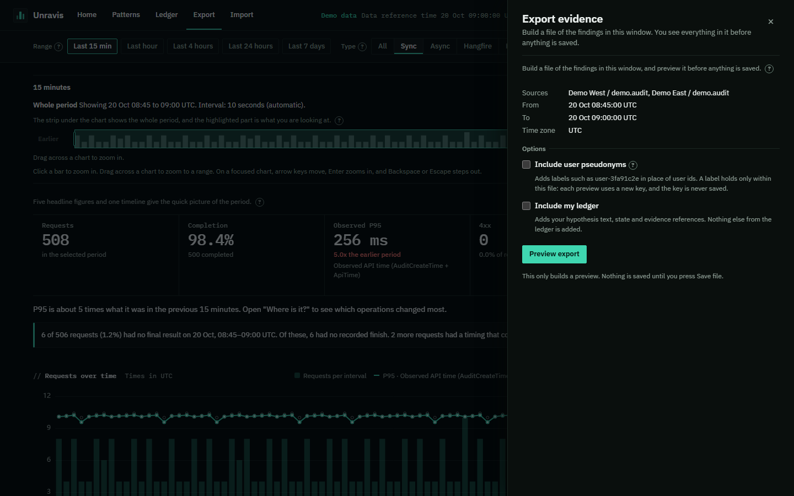
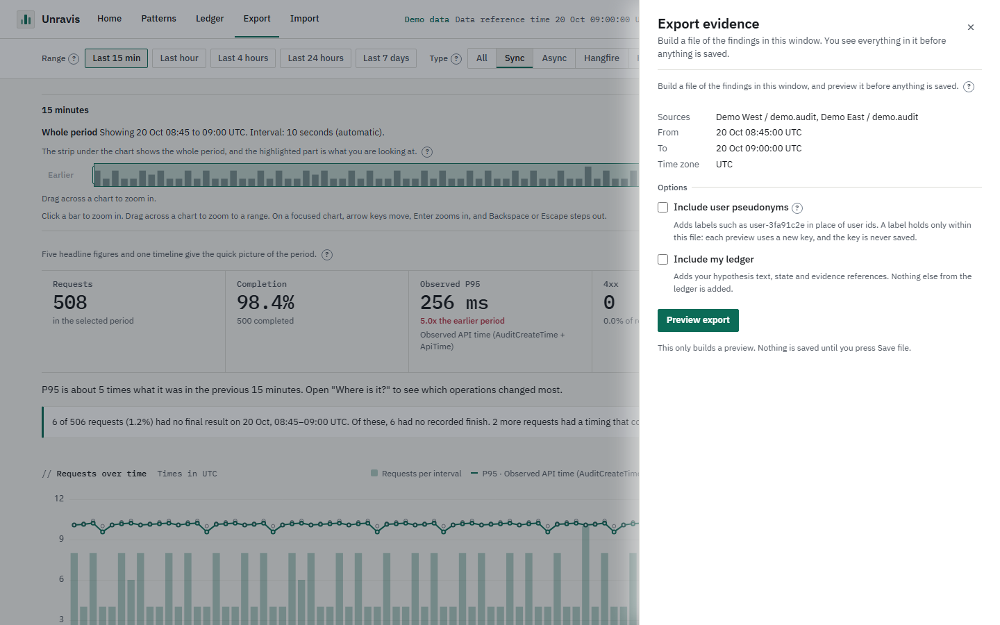

## Coming later

- Close and reopen a case, the retry list, and two tabs on one case: Coming in P2.
- Archive, verify, free and restore: Coming in P3.
- Case keys and erase: Coming in P4.
