# Install

Unravis comes as one file, `unravis-setup.exe`. It checks the PC, asks a few questions, and puts Unravis on it. If any step fails, setup puts back everything it changed, so nothing is left half done. To move to a new version, repair, or remove Unravis, see [Upgrade and uninstall](upgrade-and-uninstall.md).

Setup never asks for a password, never connects to a database, and holds no secrets. The programs inside it are listed in a manifest with their SHA-256, and setup refuses to run if one was changed after the build.

> NOT RUN: needs a clean VM. The real Windows parts (registry, services, firewall, the Windows approval prompt, shortcuts, folder permissions) were built behind interfaces and tested with fakes on a development PC. They have not yet run on a real install.

## Checks

Screens in this part: `p11-welcome`, `p11-preflight-fail`.

Setup opens its window in Microsoft Edge or Google Chrome, in a plain app window. The first screen lists the checks it made, each with a sticker: **Ready**, **Partly ready** or **Failed**.

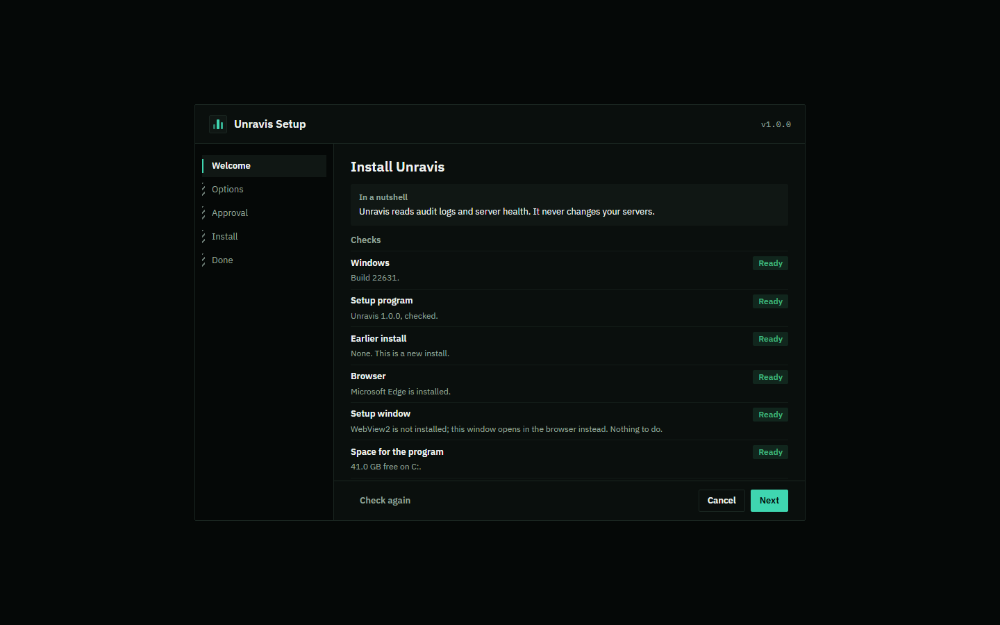
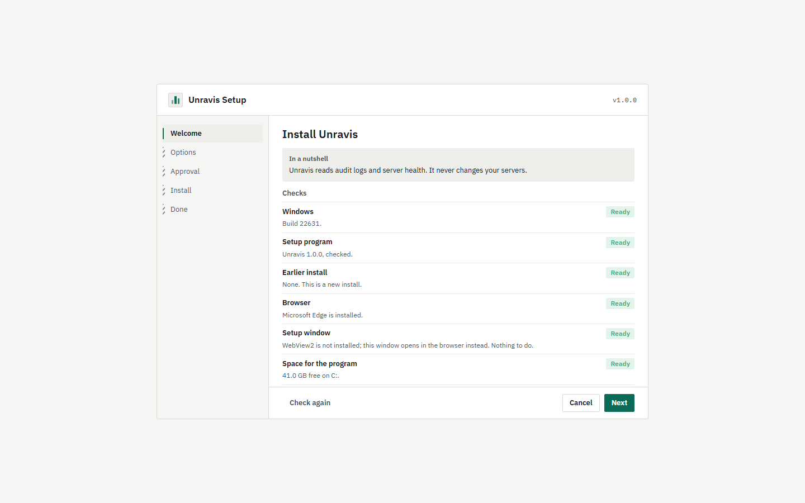

| Check | What it looks at |
|---|---|
| Windows | Windows 10 version 1809 or later, or Windows Server 2019 or later, 64-bit. |
| Setup program | The programs inside setup match their manifest. |
| Other setup | No other Unravis setup is running. |
| Earlier install | Whether Unravis is already on this PC. If it is, setup upgrades or repairs it instead. |
| Unravis open | Whether Unravis is running. Setup can close your own Unravis for you and open it again afterwards. If it is open for another person on this PC, this check fails with "Unravis is open for another person on this PC": setup never closes someone else's Unravis, so ask them to close it or sign out. |
| Blackbox service | Only when you place a Blackbox: no Blackbox is installed on this PC yet. |
| Browser | Microsoft Edge or Google Chrome, which Unravis opens in. |
| Setup window | Whether WebView2 is installed. Without it the window opens in the browser. Nothing to do. |
| Space for the program | At least 100 MB free on the drive of the program folder. |
| Space for the recordings | Only with a Blackbox: at least 1 GB free on the drive of the recordings folder. |
| Blackbox port | Only with a Blackbox: the port is free. |
| Recordings folder | Only with a Blackbox: the folder can be used. Recordings already in it are kept. |
| Administrator approval | Whether the install needs it, and whether this account can give it. |
| Restart | A restart Windows is waiting for. Setup can go on. |
| Earlier setup | An earlier setup that did not finish. Setup puts back what it changed before it starts. |
| Shared data folder | For everyone on this PC: `C:\ProgramData\Unravis` is free, or was made by an earlier setup. |
| Program folder | A new install does not go into a folder that already holds other files. For everyone on this PC, an existing folder is only used when an earlier Unravis setup made it, or when it is empty and only administrators own it. A folder that is a link to another place is refused, for this folder and for the data folders. |
| Read key file | Only with a Blackbox and a read key file in silent mode: the file does not exist yet. Setup never replaces a file. |

A **Failed** check stops the install and says what to do. Fix it, then press **Check again**. A **Partly ready** check does not stop anything.

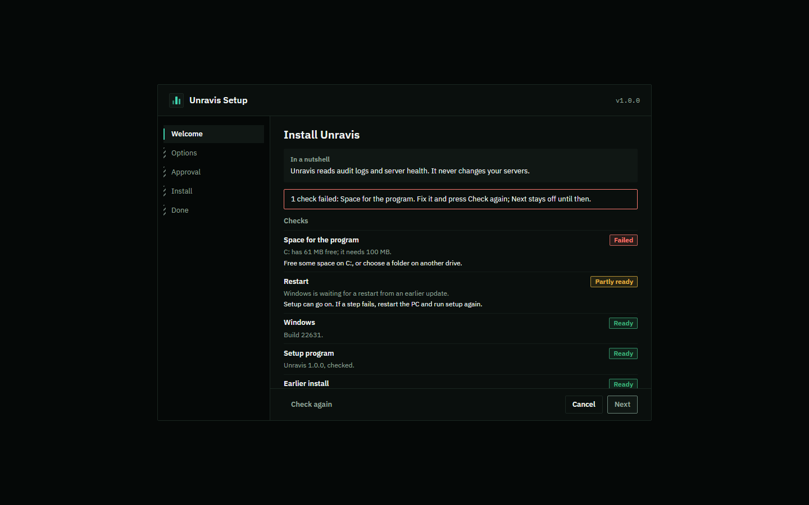
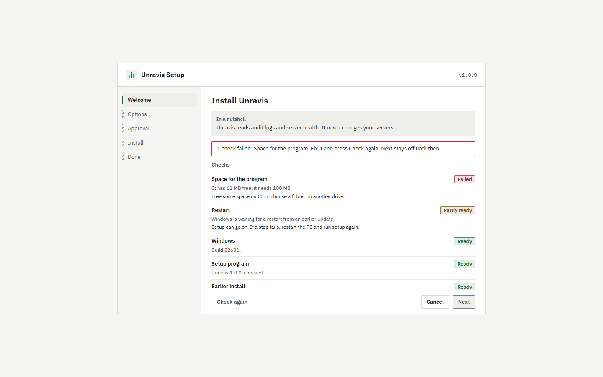

## Options

Screen in this part: `p11-options`.

- **Just for me** installs into `%LOCALAPPDATA%\Programs\Unravis`. It needs no administrator approval, unless you also place a Blackbox.
- **For everyone on this PC** installs into `C:\Program Files\Unravis`. It also makes the shared data folder `C:\ProgramData\Unravis`, records it under `HKLM\SOFTWARE\Unravis`, and sets up the key keeper service (`UnravisKeeper`) that holds saved connections for everyone. This needs administrator approval.
- **Folder.** You can type another folder. Spaces and letters such as é are fine. There is no Browse button. A name cannot end with a dot or a space, because Windows would drop it. Short names such as `PROGRA~1` are read as the real folder before anything is checked. For everyone on this PC the folder cannot be inside a person's profile (such as `C:\Users\Ana`).
- **Start Unravis when I sign in** is ticked by default.
- **Close Unravis for me** is ticked by default. It only matters when Unravis is open.
- **Also place a Blackbox recorder on this PC** installs the Blackbox service (`UnravisBlackbox`) in `C:\Program Files\Unravis Blackbox`. It uses the same settings as the Place a Blackbox wizard: name, recordings folder, days to keep, size limit, free disk to keep, and port. See [Unravis Blackbox](blackbox.md).
- **Open the Blackbox port to these PCs** adds a Windows firewall rule, `Unravis Blackbox (TCP <port>)`, open only to the addresses you list. Without it no rule is added.

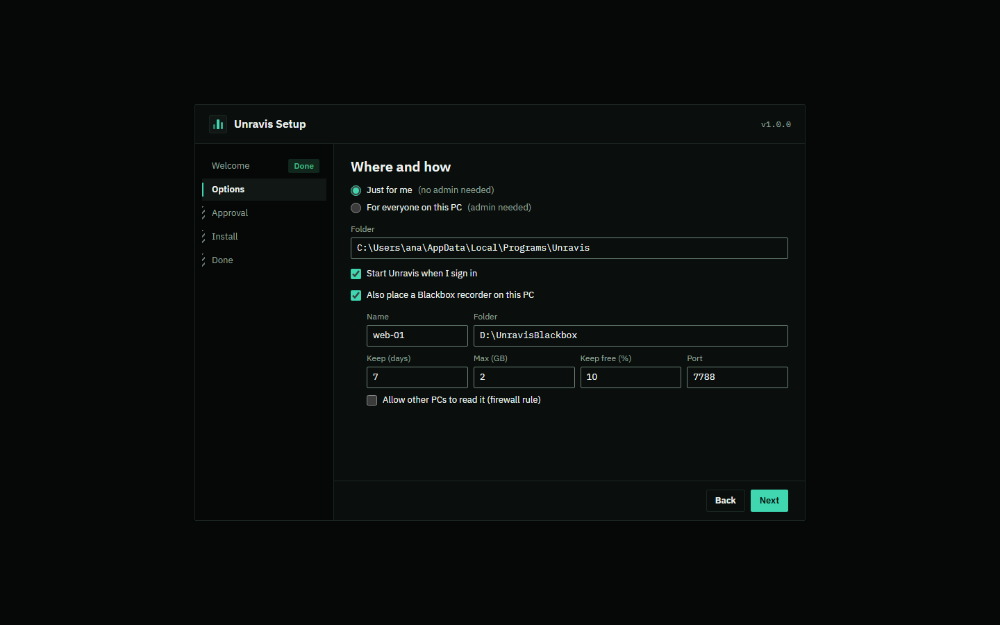
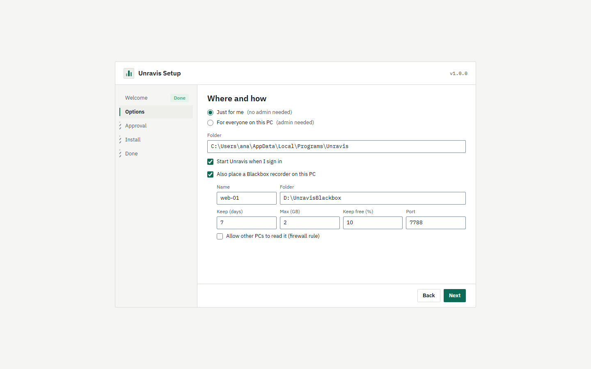

## Approval

Screen in this part: `p11-uac-explain`.

When an install needs administrator approval, setup says why before Windows asks: for example, installing for everyone on this PC and placing the Blackbox. It also lists what it will not change. Press **Continue** and approve in the Windows prompt. If you say No there, nothing is changed and you are back on this screen. When no approval is needed, the step rail shows **Not needed** for Approval.

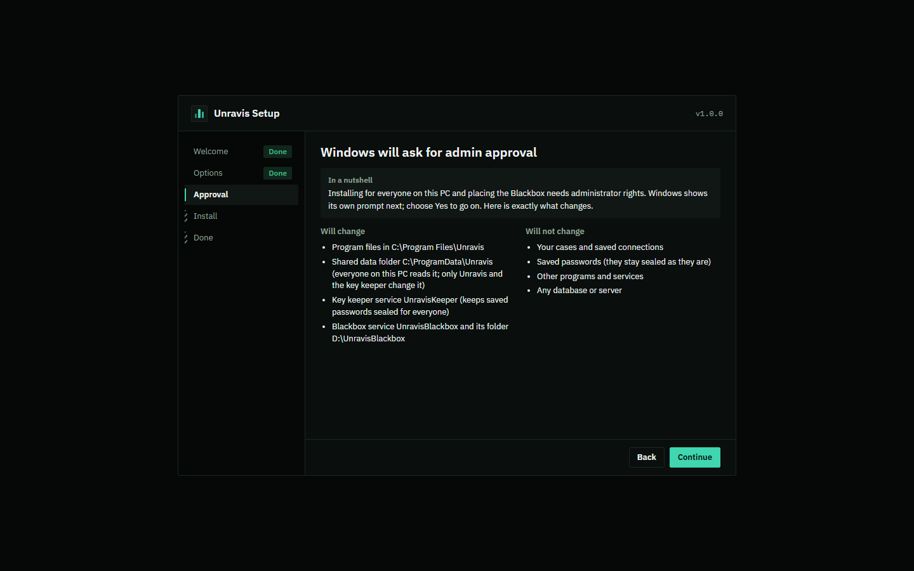
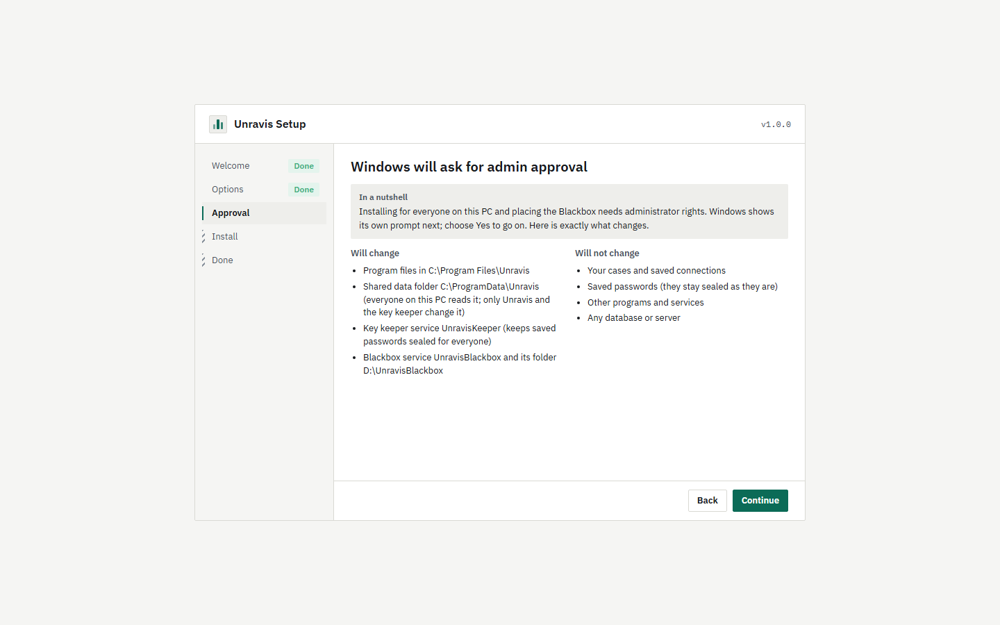

## Progress

Screen in this part: `p11-progress`.

Each step has its own row: **Waiting**, **Running**, **Done** or **Failed**. The steps for an install are:

1. Close Unravis (only if it is open)
2. Make the program folder
3. Copy the program files
4. Make the shared data folder, record it, and set up the key keeper service (only for everyone on this PC)
5. Set up the Blackbox recorder (only if ticked)
6. Open the Blackbox port to the listed PCs (only if asked)
7. Add the Start menu shortcut
8. Add Unravis to Installed apps
9. Save the setup choices
10. Check that Unravis starts

Every change is written to a journal before it is made. **Cancel** stops the run and puts back everything it changed. Rows then show **Put back**.

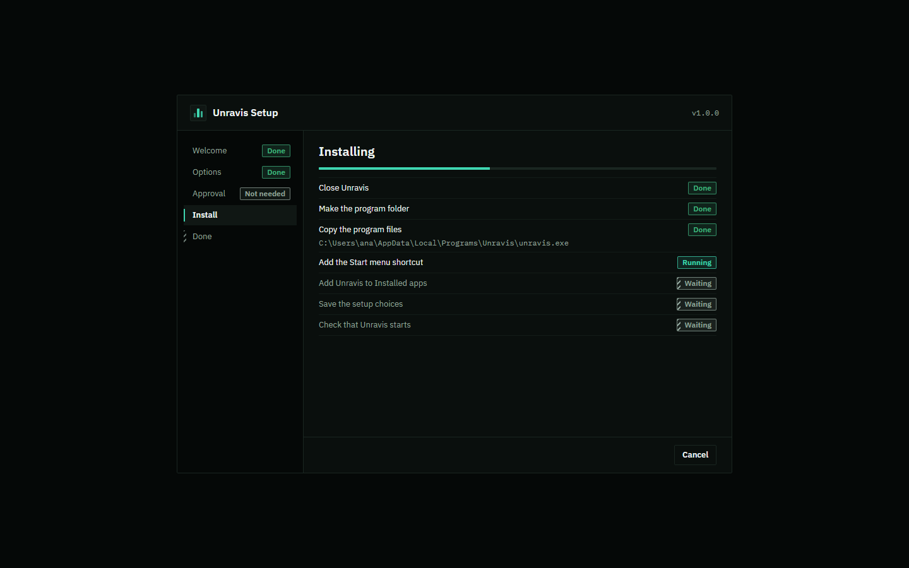
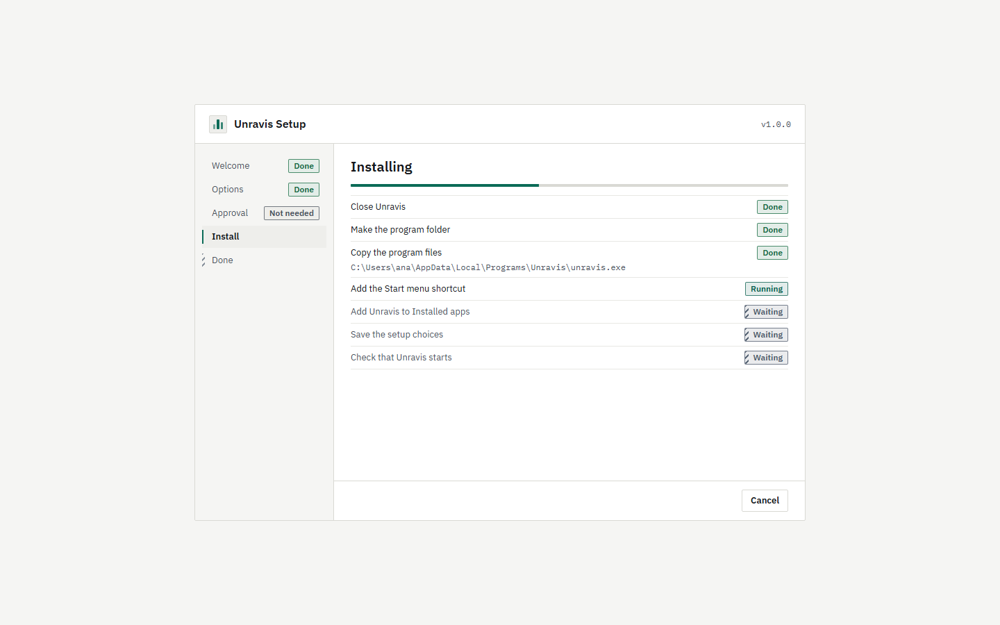

## Done

Screen in this part: `p11-done`.

When you placed a Blackbox, the Done screen shows its read key **once**. Unravis on another PC needs this key to read this Blackbox. Press **Copy** and keep it somewhere safe: **Close** and **Open Unravis** stay off until you have copied it. The key is never written to the log.

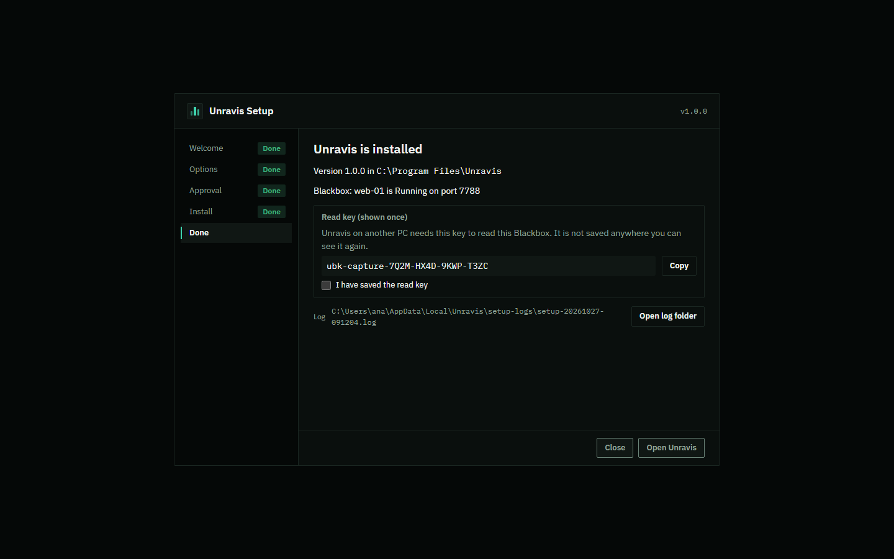
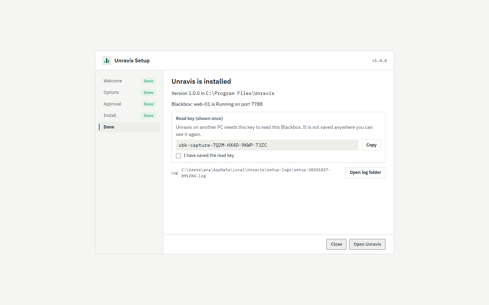

## When it fails

Screen in this part: `p11-failed-rolled-back`.

If a step fails, setup stops, puts back every step before it in reverse order, and says which step failed and what to do. The heading says whether everything was put back. If something could not be put back, it is listed by name with its path, and the log has the details. After a failed install, **Back to Options** lets you change a choice, for example the port, and run again. After a failed upgrade or repair, **Try again** runs it again (it is off when something could not be put back: read the log first).

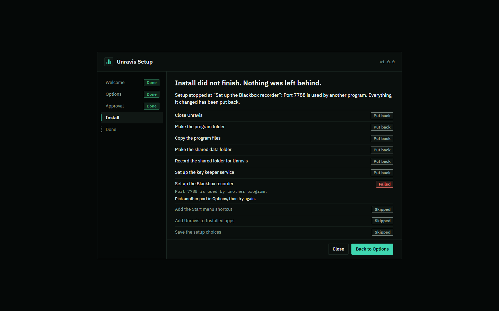
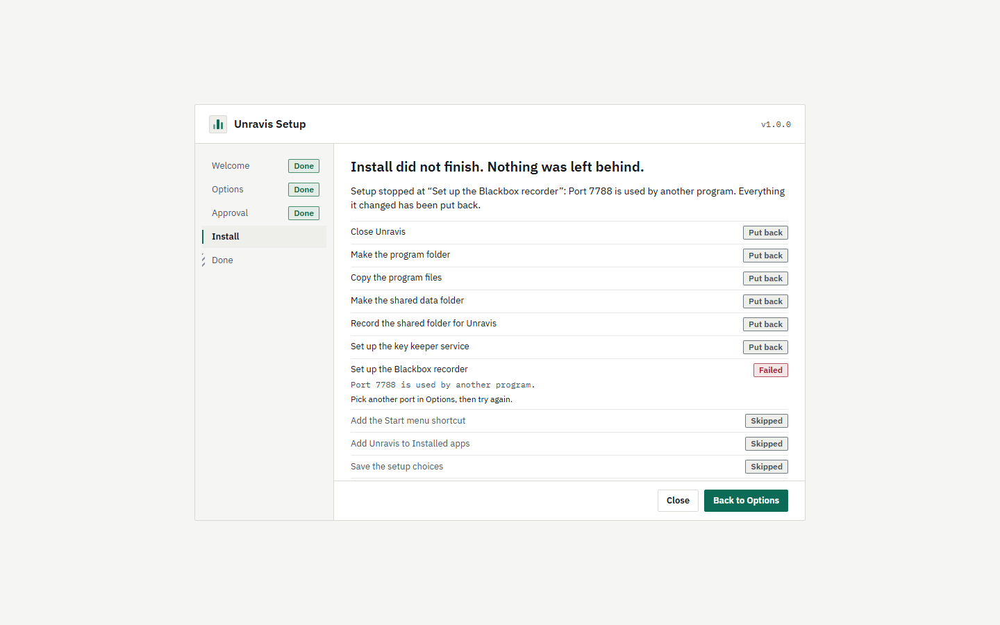

## Silent install

For scripted installs, put the choices in a file and run:

```
unravis-setup.exe --silent --config setup.json [--log C:\path\setup.log]
```

```json
{
  "scope": "machine",
  "location": "C:\\Program Files\\Unravis",
  "startAtSignIn": true,
  "blackbox": { "name": "web-01", "folder": "D:\\UnravisBlackbox", "keepDays": 7, "maxGB": 2, "minFreePercent": 10, "port": 7788 },
  "firewall": { "remoteAddresses": ["10.0.0.5", "10.0.1.0/24"] },
  "readKeyFile": "C:\\Users\\ana\\Documents\\web-01-read-key.txt"
}
```

- `scope` is required: `"user"` or `"machine"`. `location` is optional.
- `blackbox` and `firewall` are optional. `firewall` needs `blackbox`.
- `readKeyFile` is required when a Blackbox is placed. The read key is written there once, readable only by you. The file must not exist yet: setup never replaces a file, and it makes the new file with its permissions already set. Silent mode shows it nowhere else.
- `startAtSignIn` defaults to true. `openWhenDone` is accepted but ignored: silent mode never opens a window.
- Keys are case sensitive. An unknown key, a wrong type, a second JSON value or a file over 64 KB stops setup with a sentence that names the problem, before it changes anything. A Notepad UTF-8 mark at the start is fine.

Silent mode never closes a running Unravis. If it is open, the check fails and setup stops.

### Exit codes

| Code | Meaning |
|---|---|
| 0 | Done. |
| 1 | A check failed. Nothing was changed. |
| 2 | The command line or setup.json is wrong. Nothing was changed. |
| 3 | The Windows approval was refused. Nothing was changed. |
| 4 | A step failed, or the run was cancelled, and everything was put back. |
| 5 | Anything else, including items that could not be put back or removed. Read the log. |

## The log

Every run writes a log to `%LOCALAPPDATA%\Unravis\setup-logs\setup-YYYYMMDD-HHMMSS.log`, or to the path given with `--log`. The part that runs with administrator approval writes its own log next to it, with `-admin` at the end of the name. The Done and failure screens show the path. The log holds steps, paths and errors. It never holds the read key or any password.

## Other command-line options

| Option | What it does |
|---|---|
| `--upgrade`, `--repair`, `--uninstall` | Start in that mode. See [Upgrade and uninstall](upgrade-and-uninstall.md). |
| `--allow-downgrade` | Allow an upgrade to an older version. |
| `--no-browser` | Print the window's address instead of opening it. |
| `--version` | Print the version and exit. |

Running setup a second time while Unravis is installed does not install it twice. It offers to upgrade, or to repair when it is the same version.
