# Sources

A source is where Unravis reads from: an audit log, a SQL Server or a MongoDB. Unravis only reads from a source.

## The Sources drawer

Press the sources button in the header to see the sources Unravis knows and to choose which ones to include in the analysis.

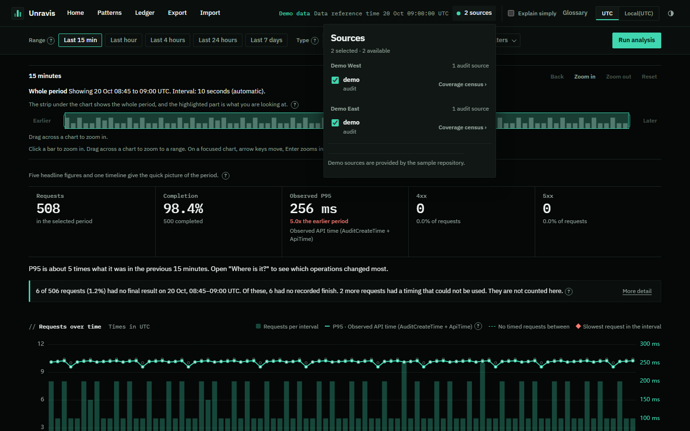
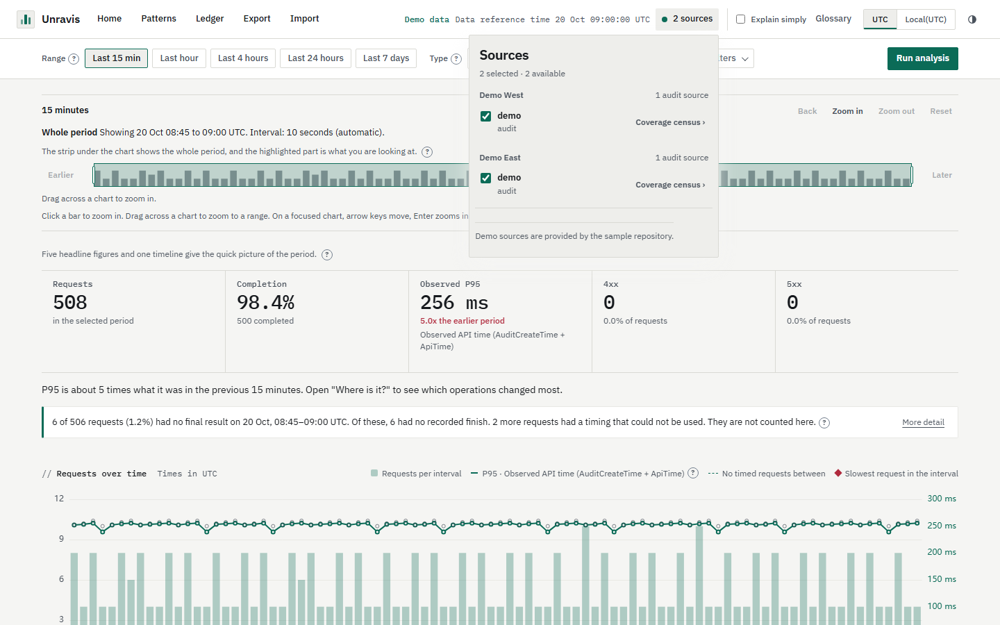

The demo uses sample sources and does not let you add real ones, so the pictures above show the drawer with adding blocked. Pictures with a connected source arrive with the connection phase.

## SQL Server, MongoDB, grants and the profiler guide

A case can read a SQL Server and a MongoDB server on top of its audit logs. They answer two questions the logs cannot: did the database slow down, and when did it start. Unravis only reads. It never changes a server, never runs a grant for you and never switches a profiler on.

The case page has a section called SQL Server and MongoDB. It holds six tabs: Connections, Step 7: SQL Server, Step 8: MongoDB, Add data, Add another day and Combinations. The guided steps show the same Step 7 and Step 8 panels.

Pictures for this page come from the screenshot tool (see `screenshots.md`). Each screen below has a dark and a light picture. They were made on a developer PC and are replaced when the reference runner regenerates the baselines.

### Saved connections

Screen `p7-connections` lists every saved connection, SQL Server and MongoDB, in one list. Each row shows its name, whether a password is saved, and the result of its last test.

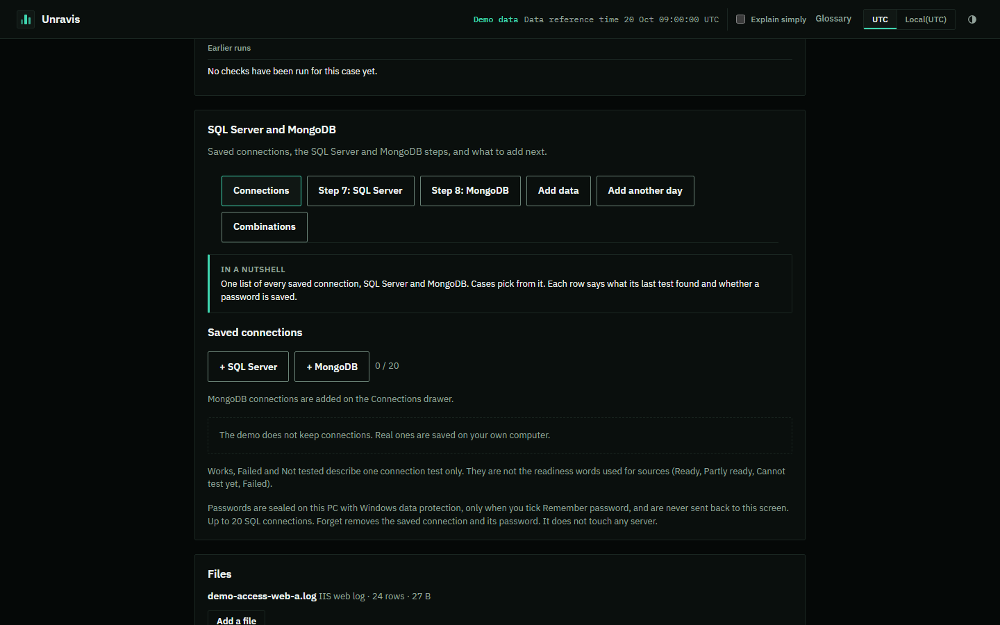
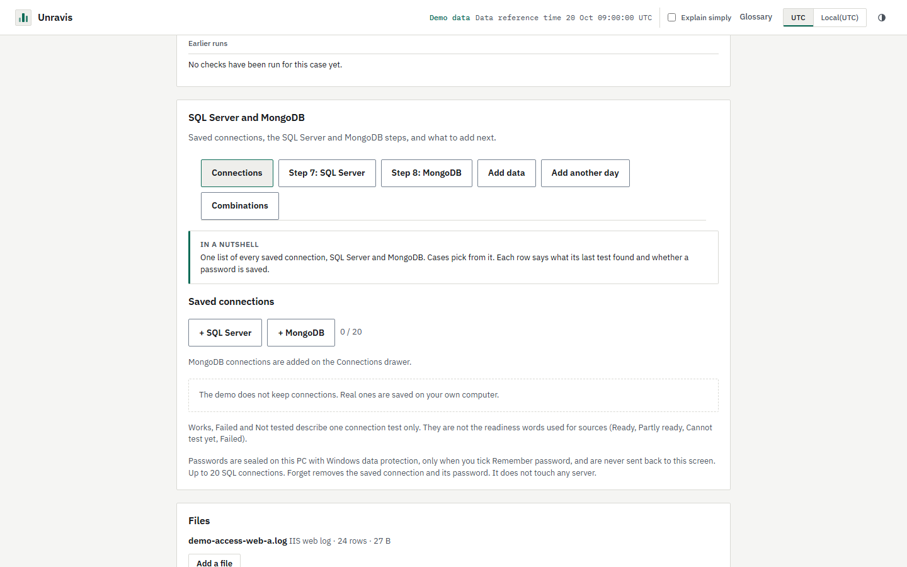

- A test says only Works, Failed or Not tested. These three words are for a connection test and nothing else. A source is never "Works". It is Ready, Partly ready, Cannot test yet or Failed.
- The last test result is kept only while the page is open. It is not saved in the case.
- A saved password is never shown and never sent back to the screen. A row only says that one is saved. Passwords are sealed on this computer with Windows data protection, and only when you tick Remember password.
- Forget asks once. It removes the saved connection and its password. It does not touch the server.
- You can save up to 20 SQL Server connections. At 20 the add button is disabled and the page says so. If a 21st is sent anyway, the server refuses it (409) and nothing is removed.
- A wrong password shows Failed with the server's own message. It never shows the password.
- The demo has a sample SQL Server and a sample MongoDB already saved, and it keeps what you add only while it runs. It never opens a real connection and never keeps a password. Type the database name AuditDb to read a day that works, NoGrantDb to see the grant script, EmptyDb to see Nothing read, and for MongoDB ProfilerOffDb to see the profiler guide.

### Saved connections on a PC set up for everyone (the key keeper)

When Unravis is installed for everyone on a PC, saved passwords live in the Unravis Key Keeper service, not in Unravis (see "Saved passwords on a PC set up for everyone" in the Security page). The connections list looks the same, with three differences.

Screen `p14-connection-saved`: a row whose password is saved says "Password held by the key keeper". Test, the fixed checks and Add data still work with it: the keeper runs them and sends back only the result. The note under the list says where passwords are kept.

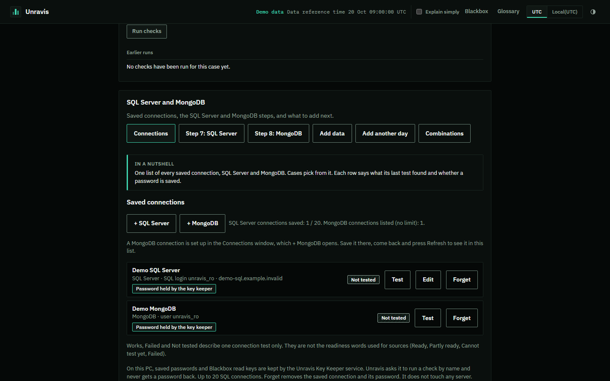
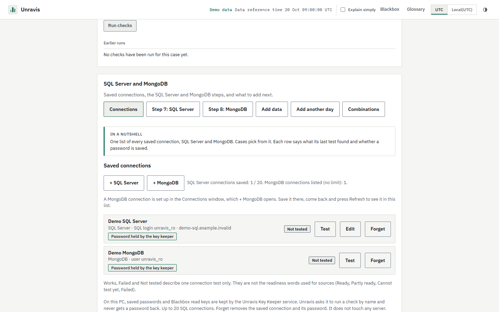

Screen `p14-keeper-stopped`: when the keeper service is not running, the page says so above the list and offers Check again. Nothing that needs a saved password runs until it is back. Connections that need no password still work. The page does not mistake this for the demo.

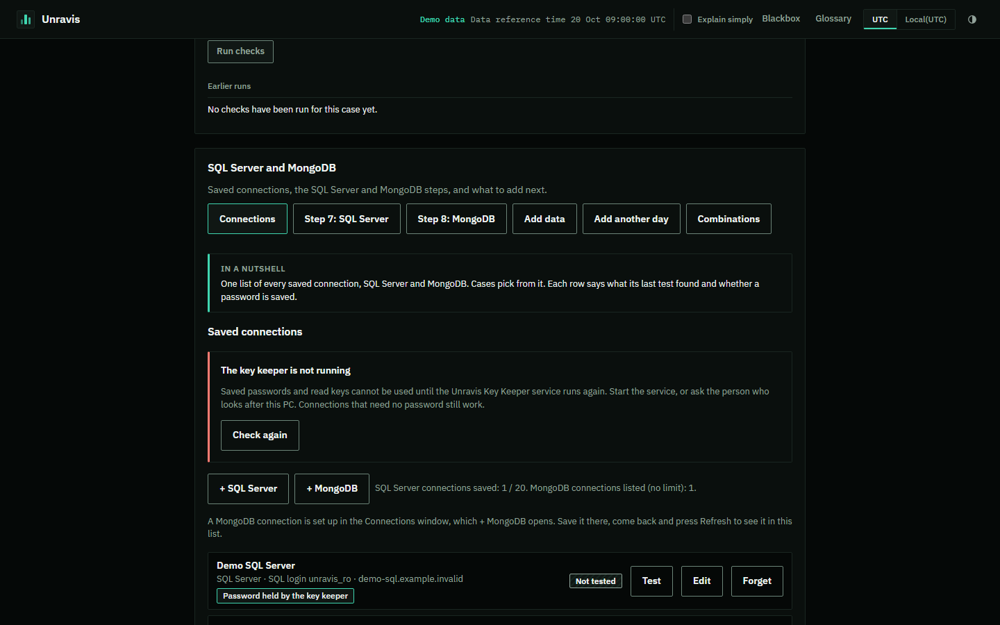
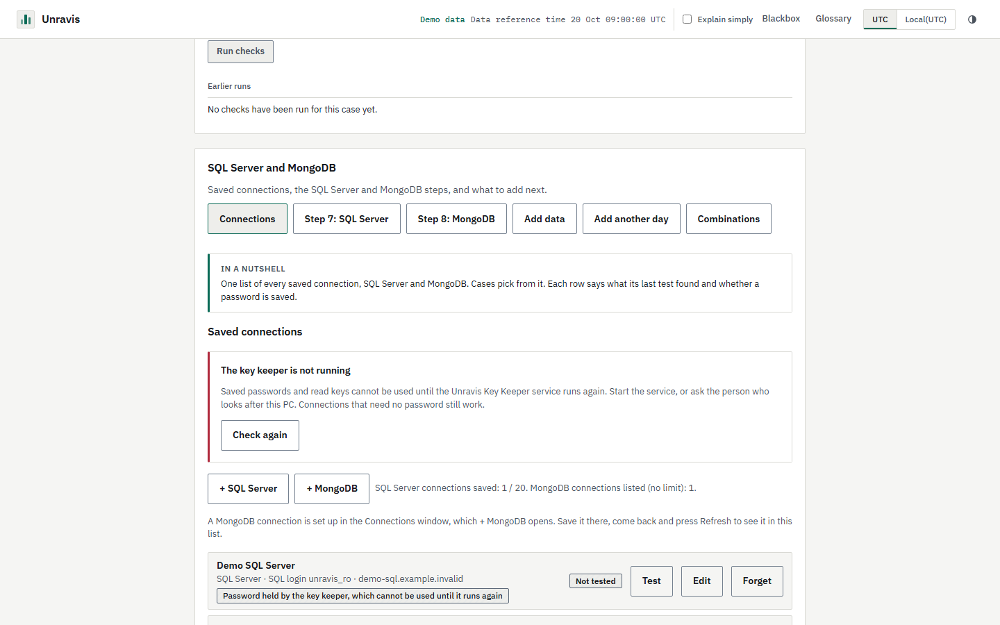

Screen `p14-migrate`: saved connections you made before the PC was set up for everyone are still in your own folder. The page counts them and offers Move them, or Not now. After the move, the page offers Remove old copies, which asks once. The old files are removed only then, and only once every one of them is in the keeper. Where this page is the whole screen, Move them is its main button and + SQL Server is outlined while the card shows; on case home, which has its own main button, both are outlined.

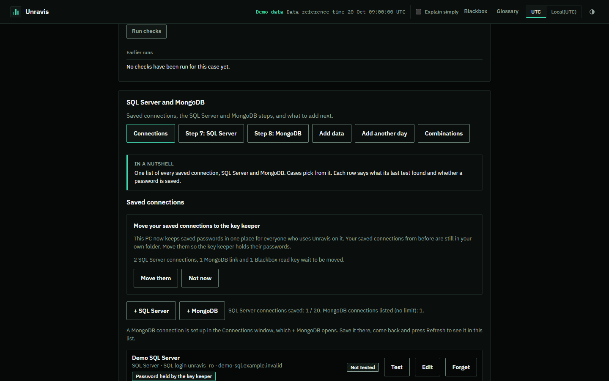
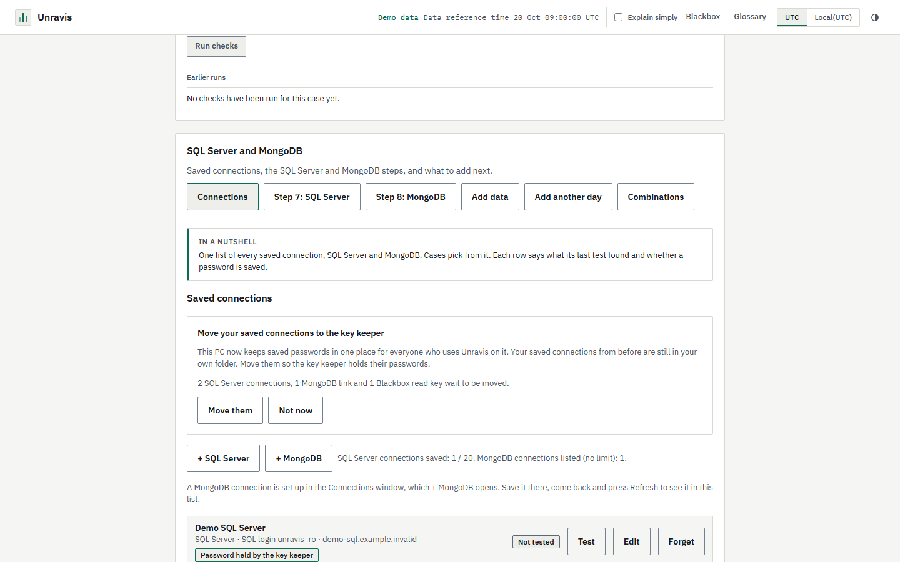

The demo shows these three states only for the pictures. It never runs a keeper and never keeps a password.

#### Audit sources from a saved MongoDB link

On a PC set up for everyone, an audit source added from a saved MongoDB link is opened by the key keeper, with the password it stores. Unravis never receives that password. The keeper reads the audit log for it and sends back only the answers. A source whose password you typed is opened by your own Unravis, as before, and the keeper never sees it.

Screen `p14b-source-held`: in the Audit sources menu, a source the keeper opened says "Password held by the key keeper". This is a sticker, not a button. Nothing asks for a password.

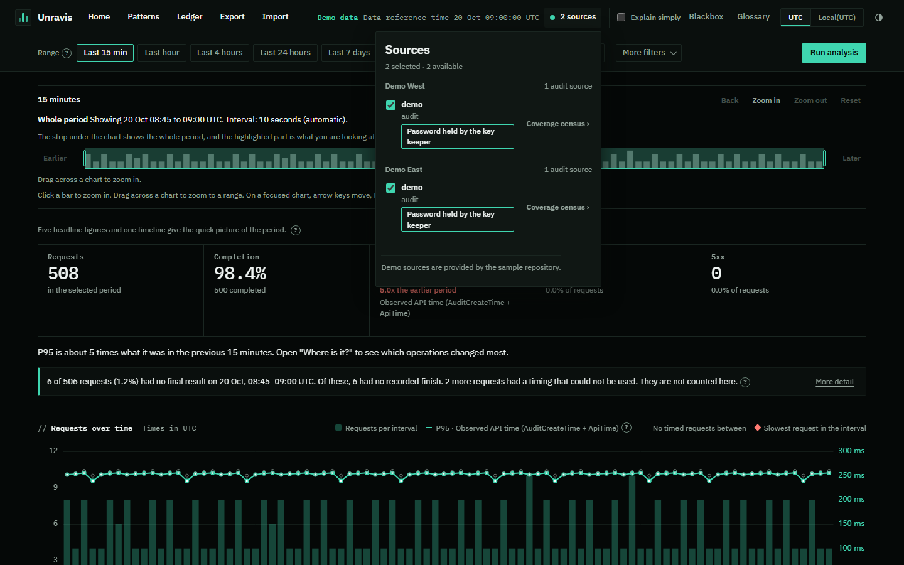
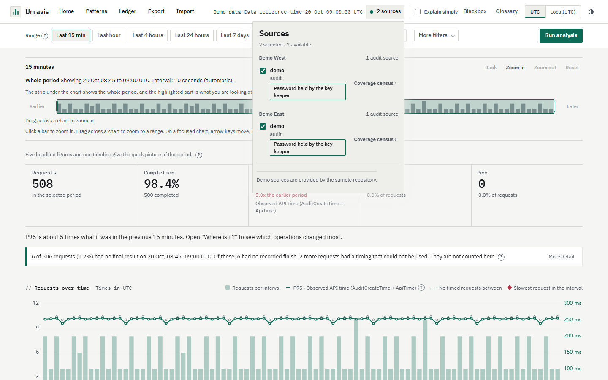

Screen `p14b-source-stopped`: when the keeper is not running, those sources stay in the menu, their sticker says the password cannot be used until the keeper runs again, and a note above the list says they cannot be read. Sources whose password you typed still work. Remove still works: it only takes the source off the list.

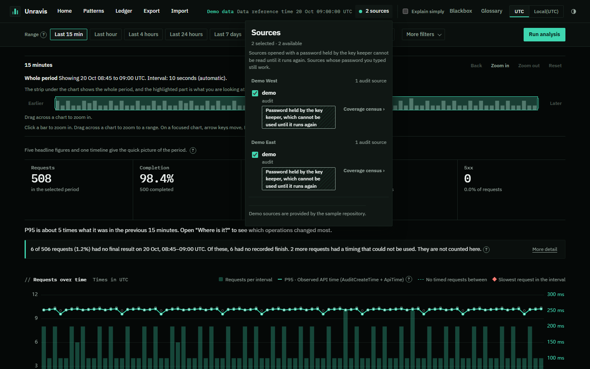
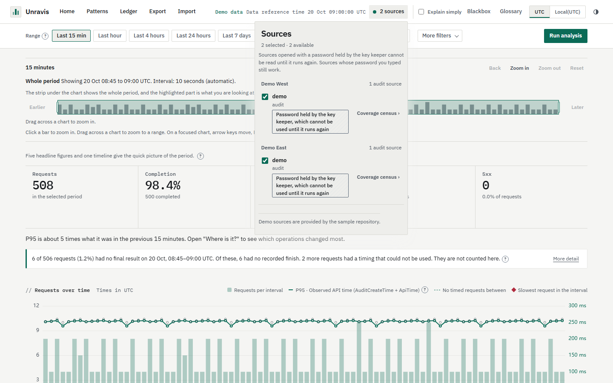

- A read the keeper refuses because it is not running, or because it closed the source, makes the page read the source list again. A source the keeper closed leaves the list the way Remove takes it off, and you add it again from the saved link.
- The keeper closes the sources of an Unravis that has not asked for anything in 8 hours, and when it restarts. It keeps sources open for at most 16 Unravis windows at once, 4 per Windows account. Past that it answers that it is full (`keeper-full`), and you close another Unravis or wait.
- One analysis reads either sources the keeper opened or sources your Unravis opened, not both (`keeper-mixed`). Only the timeline across sources takes both at once. The limit of 8 sources counts both kinds together.
- The keeper opens sources with the normal limits. A broad scan, which `--allow-broad-scans` allows in your own Unravis, is refused for a source the keeper opened. Type the password to open the source yourself if you need one.
- Error codes: `keeper-stopped` (503, the keeper is not running), `keeper-source-gone` (404, the keeper closed the source), `keeper-mixed` (400), `keeper-full` (503).

The demo shows these two states only for the pictures (`#keeper=saved` and `#keeper=stopped`). It never runs a keeper.

Screen `p7-sql-form` is the form for one SQL Server connection. Save, Test and Cancel are all outlined while the form sits on case home, because case home already has its main button. Leave the password box empty on an edit to keep the saved password.

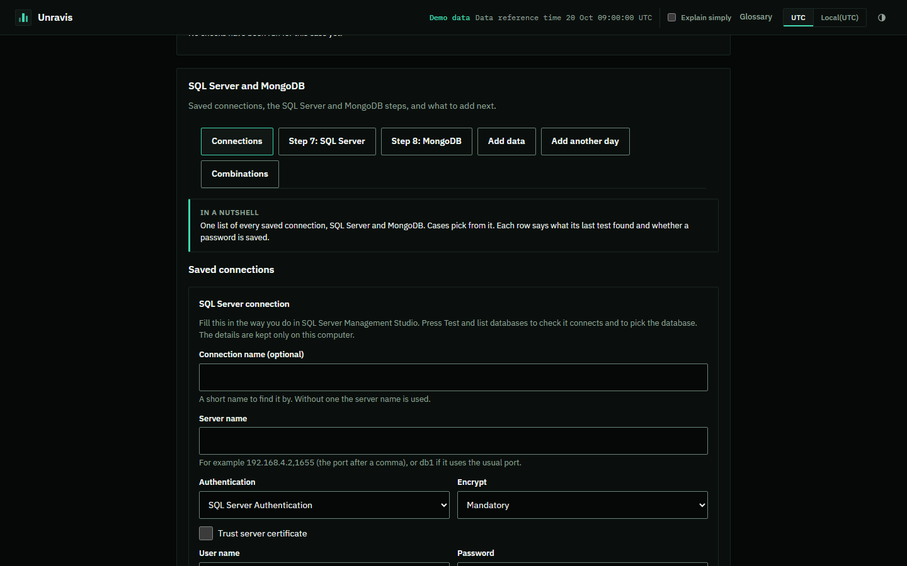
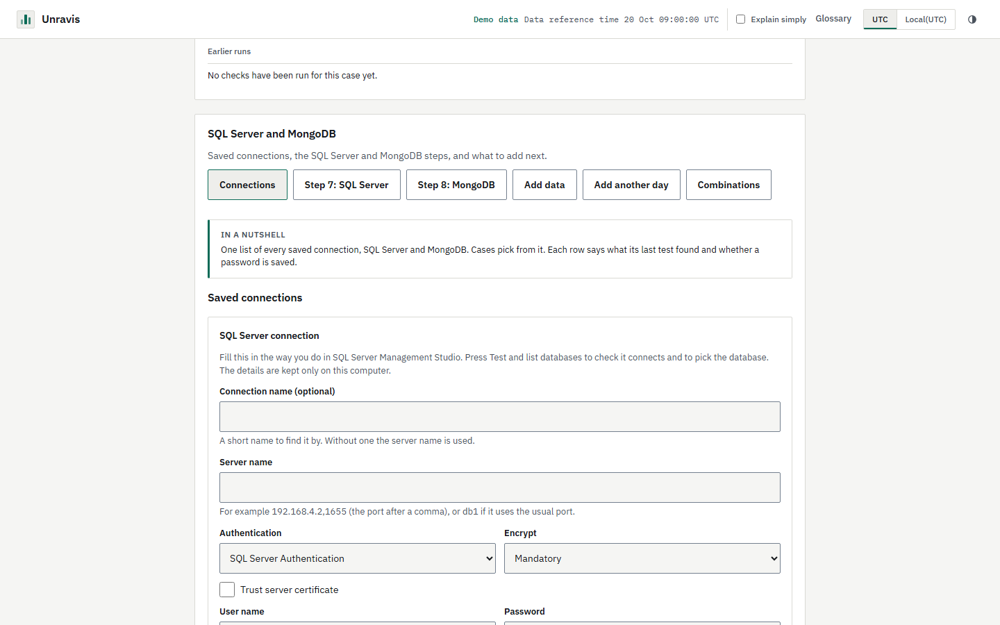

Screen `p7-sql-test-ok` is the same form after Test: the word Works and the server version sit under the buttons, and no password is shown.

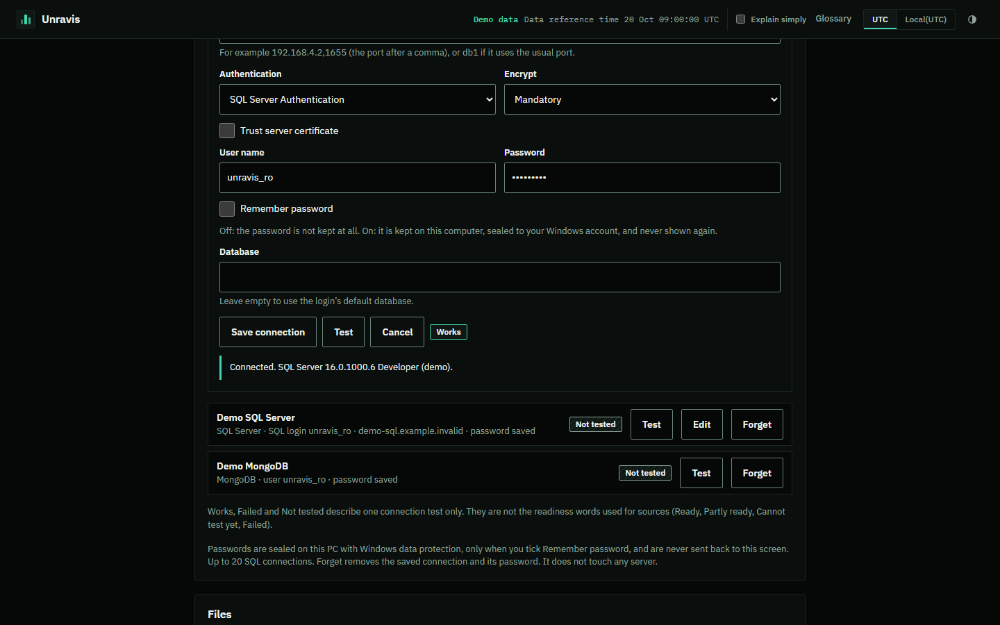
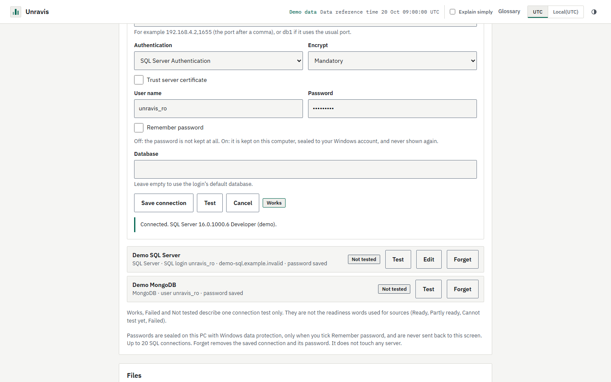

### Step 7: SQL Server

Step 7 reads one day of a SQL Server with four fixed read-only checks. Nothing you type is ever run as a query.

| Check | Reads | Answers |
|---|---|---|
| Server start and thread pool | server start time and thread pool waits | D5, D12, D13 |
| Error log | the SQL Server error log | D5 |
| Query Store | hourly query timings, regressions and plan changes | D3, D14, D15 |
| Agent jobs and backups | jobs and backups that overlap the incident | D11 |

A check that cannot run says Cannot test yet and shows the permission it is missing with the lines to fix it. The question is then left unanswered. It is never a No and never a pass. Only a check that ran, and is Ready, gives an answer. The whole read is Ready when every check ran, Partly ready when some did, Cannot test yet when none could and Failed when the server could not be read.

Screen `p7-step-7` is Step 7. With no SQL Server read yet it says Cannot test yet, shows the grant script and offers to add one.

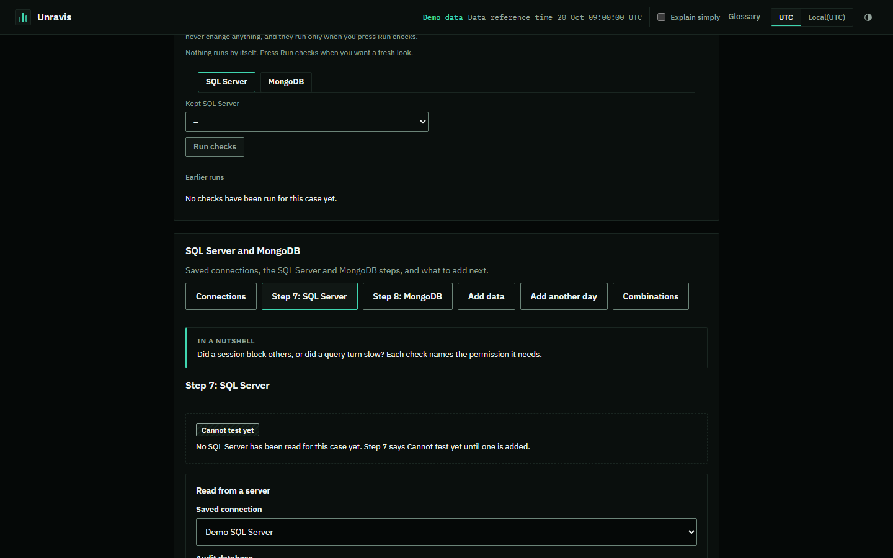
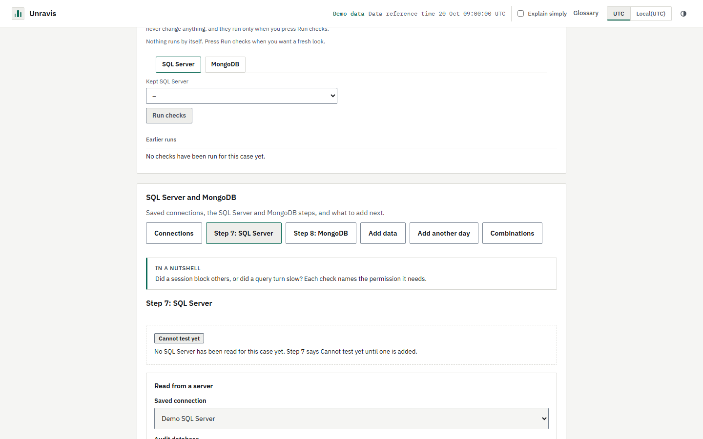

### Grants for the owner to run

Unravis never runs a grant. The panel writes the script, you copy it, and the owner of the server runs it in SSMS. Run it once per login.

SQL Server 2019 and earlier name some permissions differently from 2022 and later, so each has its own script. Do not run the 2022 script on 2019.

| Check | SQL Server 2022 or later | SQL Server 2019 or earlier |
|---|---|---|
| Server start and thread pool | VIEW SERVER PERFORMANCE STATE | VIEW SERVER STATE |
| Error log | VIEW ANY ERROR LOG | no narrower grant exists; the check stays Cannot test yet unless the owner chooses to allow securityadmin |
| Query Store | VIEW DATABASE PERFORMANCE STATE | VIEW DATABASE STATE |
| Agent jobs and backups | read on msdb (SQLAgentReaderRole) | read on msdb (SQLAgentReaderRole) |

Screens `p7-grant-script-2019` and `p7-grant-script-2022` show the same panel with each version chosen. Type the login and the audit database to fill them into the script. The version is read from the server on a read, and 2022 is assumed when it is unknown.

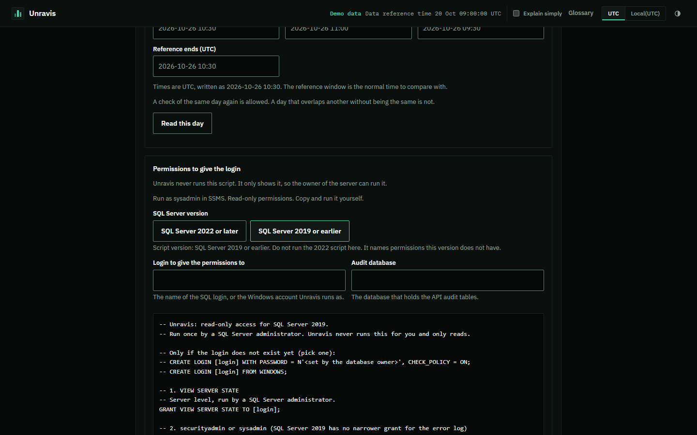
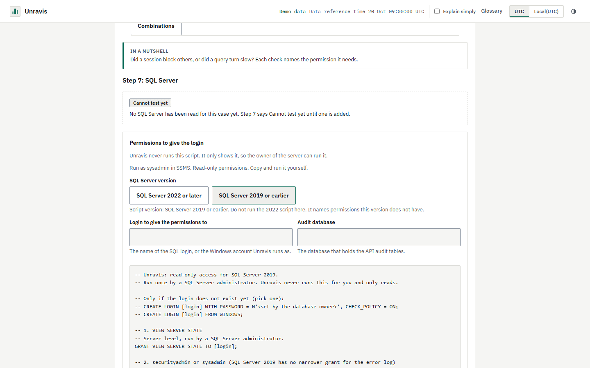
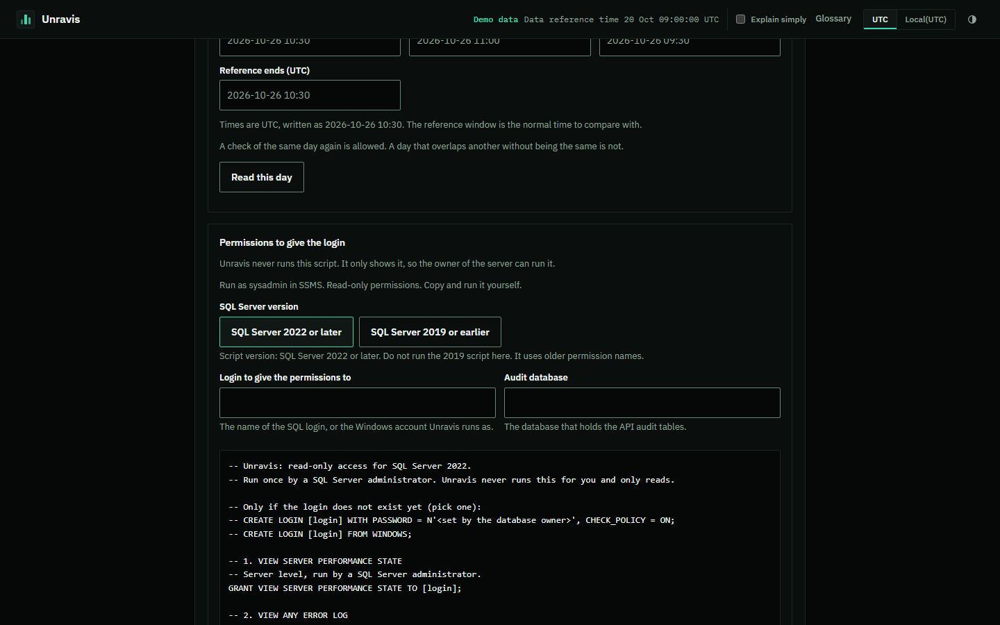
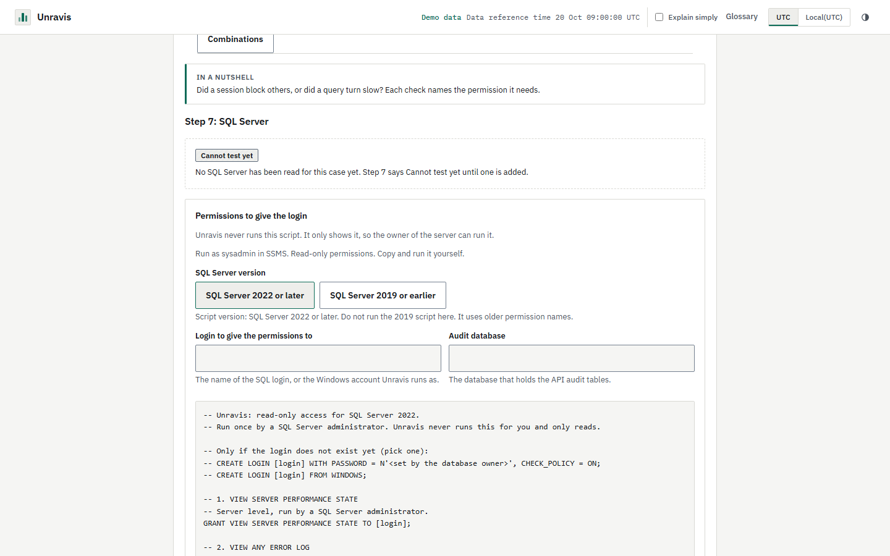

### Step 8: MongoDB

Step 8 reads the MongoDB server itself, not the audit logs. The user needs the clusterMonitor role on admin and the read role on the audit database. The panel shows the script for the owner to run in mongosh.

Step 8 currently checks the slow operations the profiler recorded (answer M6) and when they began. Other Mongo questions need a time series and are not read yet. The screen says so rather than guessing.

Screen `p7-step-8` is Step 8. With no MongoDB server read it says Cannot test yet and shows the roles script and the profiler guide.

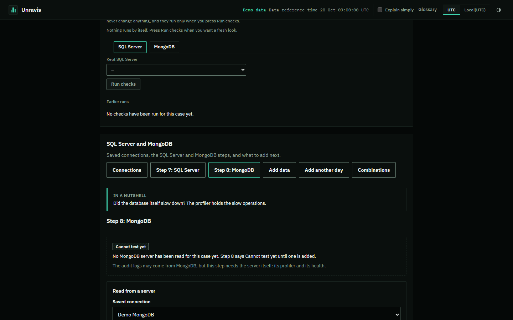
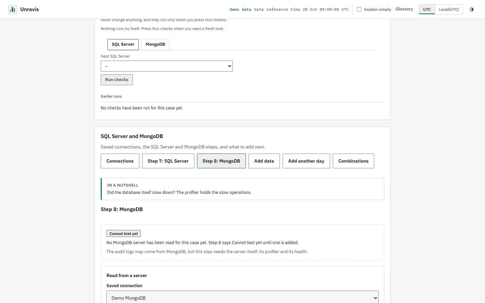

### The profiler guide

The MongoDB profiler is how slow operations are seen. It is off by default. The Switched on? guide explains why it matters, what it costs, and the steps. It has three scripts: Check that it is on (read-only), Switch it on and Switch it off again. The switch-on script replaces the profiler record collection, so older records are lost. Pick a quiet moment, run it as a MongoDB administrator, then read the database again. Unravis cannot switch it on and never tries. The guide appears on Step 8 and carries the database name you gave.

### Add data

Screen: Add data tab. It has five cards: SQL Server, MongoDB, Blackbox, Files and Another day. **Add a Blackbox** opens the Blackbox page, the same one the header opens, where a Blackbox is added and then used in this case. It is off in a closed case. Each card says how many saved connections are ready and how many reads the case already holds. Adding reads the new data on its own and does not touch what is there. A step that ran before the new data arrived is marked Out of date, rerun. It does not change by itself.

### Add another day

Screen `p7-add-day` reads more hours of a SQL Server the case already holds, for example the day after a fix. The times start as the same hours on the next day and are UTC. They are read as typed and strictly: a time that cannot be read is refused, not guessed.

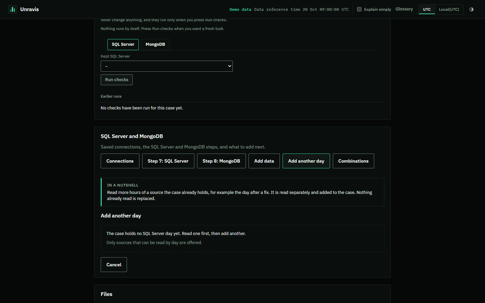
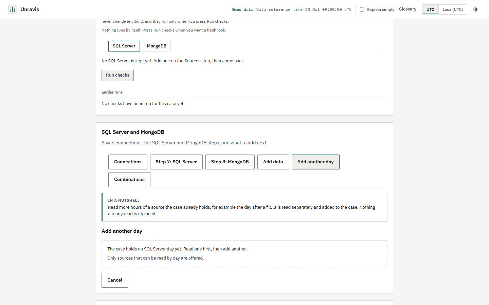

- Only SQL Server can be read by day. MongoDB is listed as Not by day, because the profiler keeps only the latest entries and an older day cannot be read.
- A day is added next to the days already held. Nothing is replaced.
- Reading exactly the same hours again is a re-check and is allowed.
- Hours that overlap a day already held for the same server and database, without being the same, are refused. Nothing is read.
- With no SQL Server day in the case, the screen says so and asks you to read one first.

### When nothing could be read

Screen `p7-nothing-read` appears when the server answered but every check came back Cannot test yet and none has a grant to fix. The case is not broken. The hours may be wrong, or that hour is before the system was used. The screen lists what the case can and cannot answer and offers Add another day or Add data. It never says a check passed. In the capture demo it is the case Report export timeouts, 18 October, which holds one SQL Server day with nothing read.

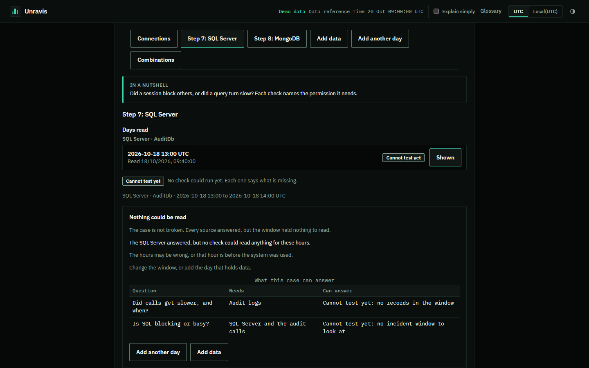
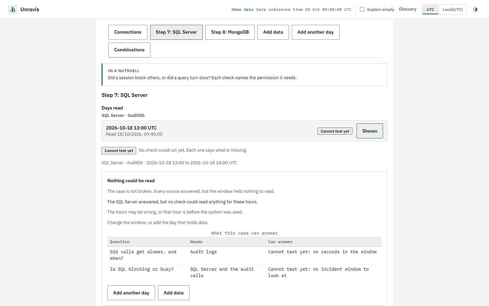

### What each combination can answer

The Combinations tab shows what each set of sources can answer, so you know what to add next.

| The case holds | Steps it can answer | Steps that say Cannot test yet |
|---|---|---|
| Mongo audit logs only | 0, 1 (partly), 2, 3 (A, C and D), 4, 6, 10 (from what exists) | 3 (O needs IIS), 5, 7, 8, 9 |
| plus IIS logs | adds O in step 3, and queueing in 4 | 5, 7, 8, 9 |
| plus SQL Server | adds 7, and the jobs and error log lanes of 5 | 8, 9 |
| plus a MongoDB server (profiler, clusterMonitor) | adds 8 | 9, the host lanes of 5 |
| plus a Blackbox on the web server and on the SQL host | adds 9, the host lane of 5 and SQL host counters | none from missing sources |

The last row of the tab says what the case holds today. Application logs add lines to Step 5 only. A Query Store export is for a SQL Server you cannot connect to. Neither is needed to start.
