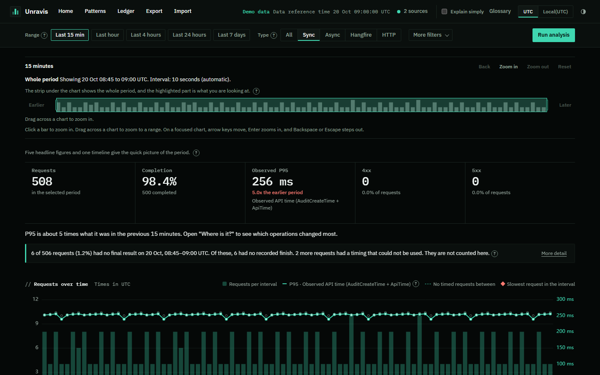
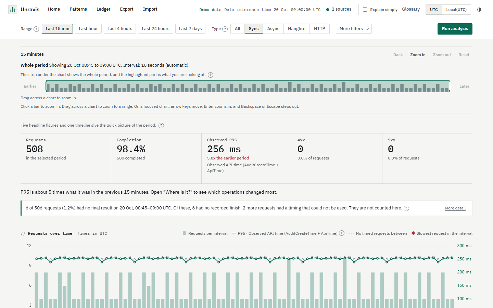
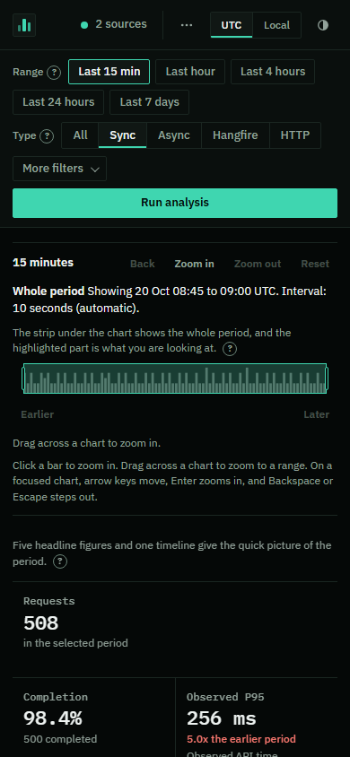
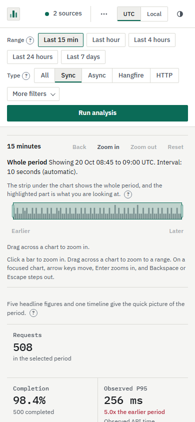
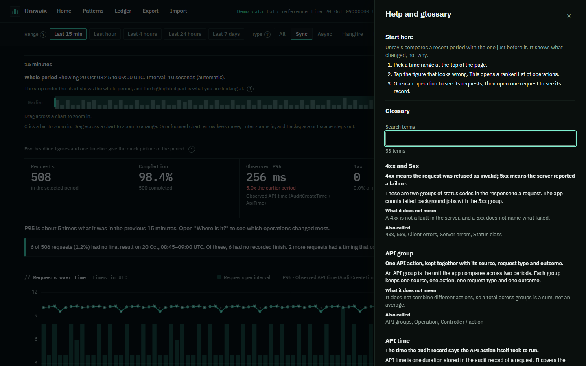
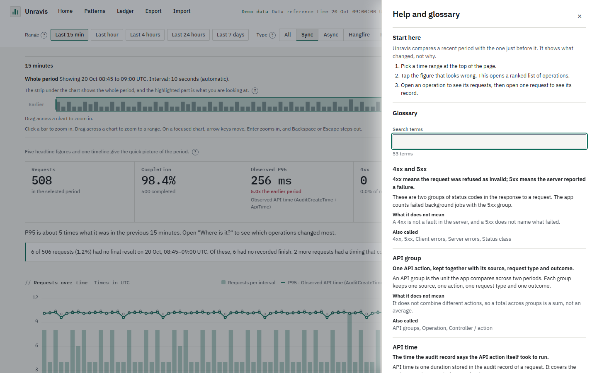

# Getting started

## What you need

- Windows 10 or 11, or Windows Server 2019 or later.
- A web browser. Unravis opens its screens in your own browser, on your own computer. Nothing is sent to the internet unless you press Check for updates.

## Start Unravis

Run `unravis.exe`. Your browser opens on the Unravis start page. Unravis listens only on your own computer (the loopback address), on a port that Windows picks for you.

If you would rather open the page yourself, start it with `--no-browser`:

```
unravis.exe --no-browser
```

Unravis then prints a one-time link in its window. Paste the link into your browser. The link works once and expires after 10 minutes. To open Unravis again, restart it.

Other options:

| Option | What it does |
|---|---|
| `--demo` | Runs with made-up sample data, so you can look around without any logs or servers. |
| `--port 8080` | Uses a port you choose. Without it, Windows picks a free one. |
| `--version` | Prints the version and stops. |

An older copy of the program, `api-audit-explorer.exe`, still starts the same Unravis.

## Check the version

```
unravis.exe --version
```

The line shows the version, the commit it was built from and the build date, for example `Unravis v1.0.0 (commit 065fbfd, built 2026-10-27)`. A build that was not made from a release shows a short commit name in place of the version number. Quote this line when you ask for help.

## Try the demo

```
unravis.exe --demo
```

The demo shows a quiet 15 minutes of sample traffic from two sample sources. The time at the top reads "Data reference time", because the sample data stands still at one moment.




The same page on a narrow window, such as a small laptop or a phone-sized browser. The header folds some buttons into a More menu.




## The Glossary

Press Glossary in the header for plain-words meanings of the terms Unravis uses. Turn on Explain simply to see short hints beside the figures.




## Help inside Unravis

The Glossary button in the header opens Help. Help holds the glossary and the same pages as this guide. Press Open the user guide in Help to read them. The pictures are left out in the app. Each picture shows a short line of text instead.

Screens in this part: `p13-guide-index`, `p13-guide-page`.
