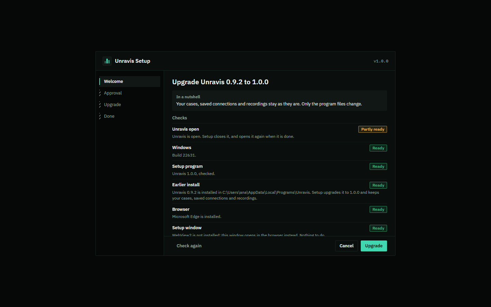
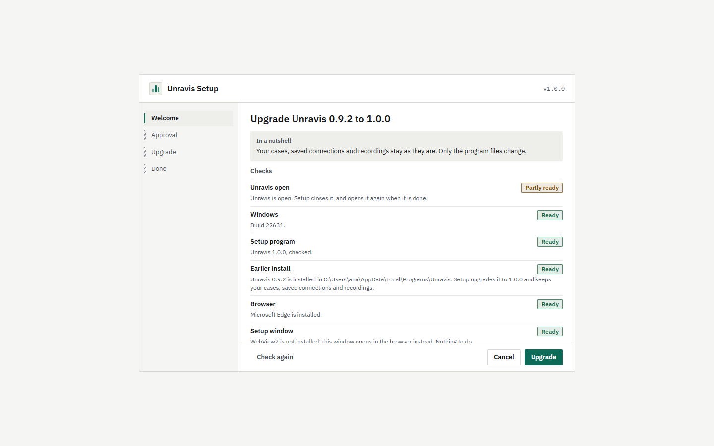
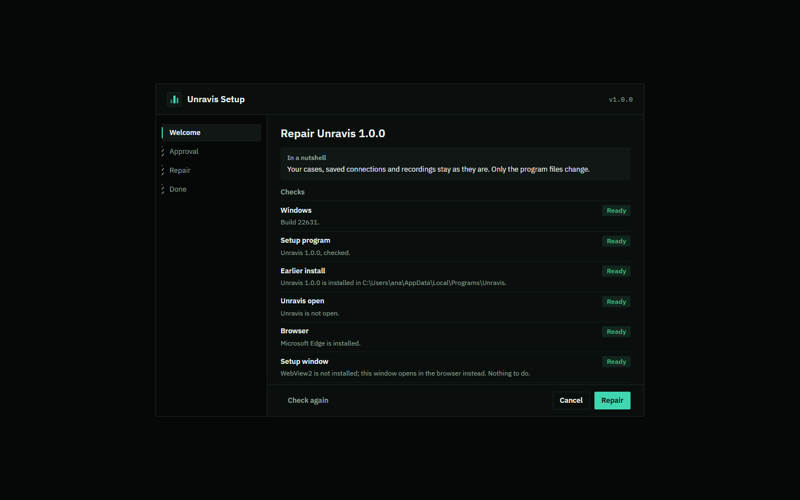
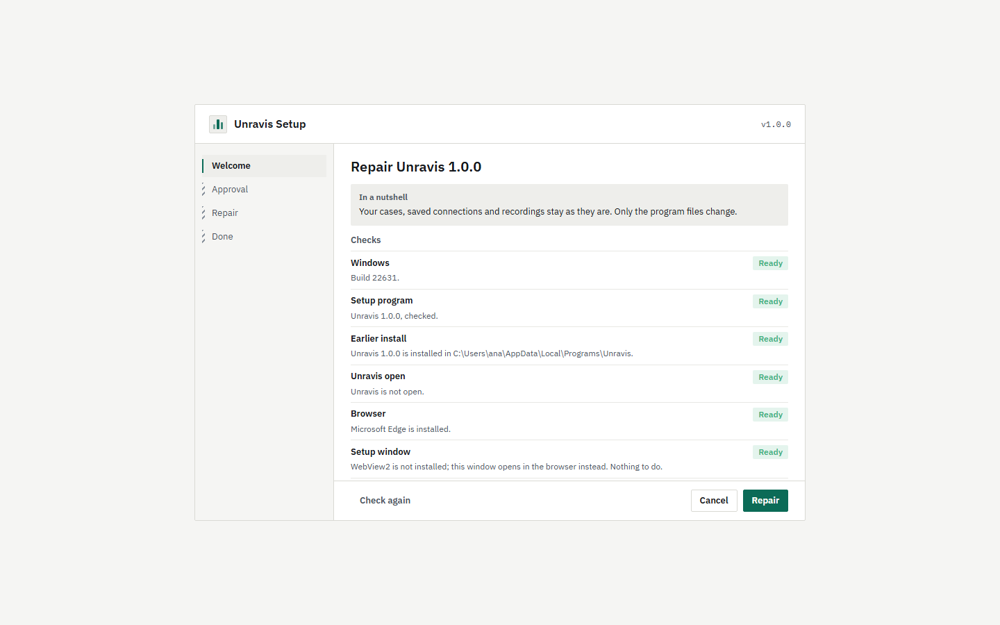
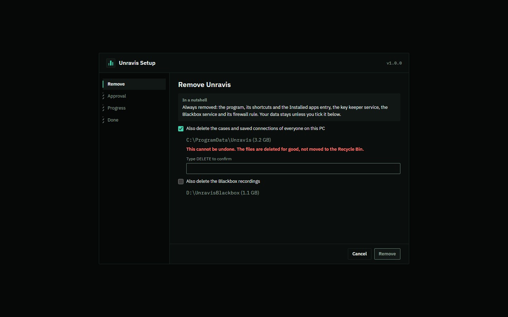
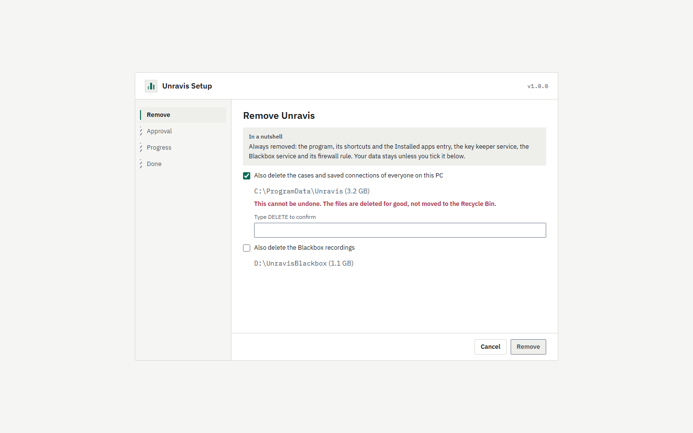

# Upgrade and uninstall

The same `unravis-setup.exe` upgrades, repairs and removes Unravis. Run a newer setup over an installed Unravis and it upgrades it. Run the same version again and it repairs it. To remove Unravis, use **Installed apps** in Windows Settings, or run `unravis-setup.exe --uninstall`. For a first install, see [Install](install.md).

> NOT RUN: needs a clean VM. Upgrade, repair and uninstall were tested with fakes for the registry, services, firewall and the Windows approval prompt. They have not yet run against a real install.

## Checking for a newer version

Screens in this part: `p12-update-none`, `p12-update-available`, `p12-update-offline`.

Unravis never checks for a new version by itself. You check when you want to: open **Glossary** in the header (the help panel) and press **Check for updates** at the foot. Unravis asks GitHub for the latest release of `abhinavjp/unravis`. The request goes to api.github.com. It sends nothing about you or your cases.

There are four answers:

- **You are on the latest version (v1.2.0).** Nothing to do.
- **Version 1.3.0 is available. You have v1.2.0.** A link, **Open the release page**, opens the release on GitHub.
- **Could not check for updates. Check your connection and try again later.** This also shows when you are offline or GitHub has rate-limited the check.
- **This is a development build, so there is nothing to compare.** Development builds do not check for updates.

Unravis makes no background calls. The check runs only when you press the button.

Installing a newer version is still your step. Download the installer from the release page, check it against `SHA256SUMS.txt` from the same release, and run it. It upgrades in place.

## Upgrade

Screen in this part: `p11-upgrade`.

The heading names both versions, for example **Upgrade Unravis 0.9.2 to 1.0.0**. The checks are the same as for an install. There is no Options step: the upgrade keeps the choices of the first install (scope, folder, Blackbox, firewall rule), which setup saved in `setup-state.json` in the program folder. If Unravis is open, setup closes it and opens the new version when it is done.




What an upgrade does:

- Stops the key keeper and Blackbox services, if they are installed, and starts them again with the new programs.
- Copies the new program files. The old ones go into a backup folder, `.setup-backup-<time>` in the program folder, until the new Unravis has started once. Then the backup is removed. If any step fails, the old files come back from it.
- Replaces the Blackbox program and keeps its settings, with a copy in `blackbox.json.bak` next to them.

What an upgrade never touches:

- Your cases and saved connections, in your own folder or in the shared folder `C:\ProgramData\Unravis`.
- The sealed files: saved passwords and the Blackbox read key. They are sealed with Windows data protection for one account. Setup never changes which account the keeper service runs as, because a different account could never open them again.
- The Blackbox recordings.

**Going back to an older version** is refused unless you run setup with `--allow-downgrade`. There is no button for it. An older Unravis may not read cases saved by a newer one.

## Repair

Screen in this part: `p11-repair`.

Repair puts back the program files, shortcuts, Installed apps entry, services and folder permissions, as the first install made them. It touches no data. Use it when Unravis does not start or a shortcut is gone. Run the same version of setup again, or run `unravis-setup.exe --repair`.




## Uninstall

Screen in this part: `p11-uninstall`.

Always removed: the program files, the shortcuts and the Installed apps entry. For an install for everyone on this PC, the key keeper service too. With a Blackbox, the Blackbox service and its firewall rule too.

Your data stays unless you tick it:

- **Also delete my cases and saved connections** (just for me), or **Also delete the cases and saved connections of everyone on this PC** (for everyone). Ticking it asks you to type `DELETE` to confirm. **Remove** stays off until you do. The screen shows the folder and its size.
- **Also delete the Blackbox recordings.** Ticking it asks you to type the Blackbox's name exactly.

The approval screen repeats what you ticked before Windows asks. Deleted data is deleted for good, not moved to the Recycle Bin. This cannot be undone. Copy anything you want to keep first.




What is never removed:

- The shared data of everyone on this PC, unless you tick it and type `DELETE`. Without that, the shared folder and its record in the registry stay, so a later install finds every case as it was.
- Cases from before the install for everyone, in your own folder `%LOCALAPPDATA%\APIAuditExplorer`. An uninstall for everyone never removes them.
- Files you added to the program folder yourself.

The Done screen lists what was kept and where. If something could not be removed, it is listed under **Left behind** with its path, and setup exits with code 5.

## Silent upgrade, repair and uninstall

```
unravis-setup.exe --silent --upgrade --config setup.json
unravis-setup.exe --silent --repair
unravis-setup.exe --silent --uninstall [--config setup.json]
```

An upgrade or repair always keeps the choices of the first install, whatever the config file says, so its config file can be just `{}`. A silent upgrade or repair never closes a running Unravis: close it first.

A silent uninstall without a config file keeps all data. To delete data, the config file must say so with an explicit `true`:

```json
{ "uninstall": { "deleteCases": true, "deleteRecordings": false } }
```

Anything other than `true`, `false` or a missing key stops setup with a sentence that names the key. An `uninstall` object in a config file for an install is refused. The exit codes and the log are the same as for an install (see [Install](install.md)).
